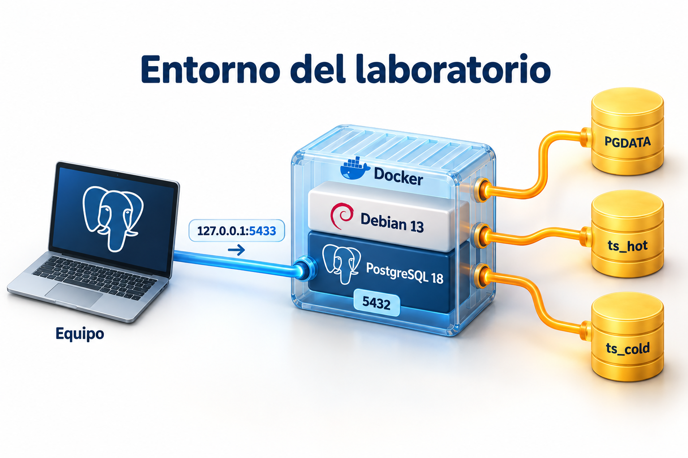
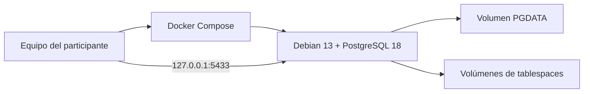

# Práctica 1.1. Instalación del Entorno PostgreSQL sobre Debian 13 (MV-Docker)

**[Lista general 🗂️](../../README.md)** | **[Capítulo 1](../README.md)** | **[Siguiente ➡️](../Practica1-2/README.md)**

## Objetivo de la práctica:

Al finalizar la práctica, serás capaz de:

- Construir una imagen Debian 13 e instalar PostgreSQL 18 desde el repositorio oficial PGDG.
- Inicializar un clúster, distinguir el usuario Linux del rol SQL y verificar autenticación local y TCP.
- Conservar los datos mediante volúmenes Docker y comprobar su persistencia.

## Objetivo Visual



El puerto `5433` del equipo se publica hacia el `5432` del contenedor. PGDATA y los dos tablespaces utilizan volúmenes persistentes separados.



## Duración aproximada:

- 45 minutos. Reservar tiempo adicional si la primera descarga depende de una conexión lenta.

## Tabla de ayuda:

| Elemento | Valor |
| --- | --- |
| Imagen base / motor | `debian:13` / PostgreSQL 18.x |
| Servicio / base / administrador | `debian-pg` / `curso` / `postgres` |
| Conexión desde el equipo | `127.0.0.1:5433` |
| Contraseña | La definida en `.env` |
| Datos y configuración | `/var/lib/postgresql/18/main` |
| Recursos del capítulo | 4 GB disponibles en Docker; 5 GB de disco libre |

## Prerrequisitos

Docker Desktop o Engine activo con contenedores Linux, Compose v2 que admita `up --wait`, Internet y una copia local del repositorio. Ver la [guía del capítulo](../README.md) para los requisitos globales del curso.

## Instrucciones

### Tarea 1. Preparar el proyecto

**Paso 1.** Abrir una terminal en la **raíz del repositorio** y acceder al capítulo:

```text
cd Capitulo01
docker version
docker compose version
docker info
```

Comprobar que `docker version` muestre **Client y Server**. Si solo aparece Client, iniciar Docker antes de continuar. Todos los comandos Docker de este capítulo se ejecutan desde `Capitulo01`, incluso cuando el README está en una subcarpeta.

**Paso 2.** Crear `Dockerfile` directamente en `Capitulo01` y guardar el siguiente contenido. En Windows, verificar que el editor no agregue la extensión `.txt`:

```dockerfile
FROM debian:13

ENV DEBIAN_FRONTEND=noninteractive
ENV PATH=/usr/lib/postgresql/18/bin:$PATH
ENV PGDATA=/var/lib/postgresql/18/main

RUN apt-get update \
    && apt-get install -y --no-install-recommends ca-certificates curl postgresql-common procps util-linux nano \
    && install -d /usr/share/postgresql-common/pgdg \
    && curl --fail --silent --show-error --location https://www.postgresql.org/media/keys/ACCC4CF8.asc \
       -o /usr/share/postgresql-common/pgdg/apt.postgresql.org.asc \
    && printf '%s\n' 'Types: deb' 'URIs: https://apt.postgresql.org/pub/repos/apt' \
       'Suites: trixie-pgdg' 'Components: main' \
       'Signed-By: /usr/share/postgresql-common/pgdg/apt.postgresql.org.asc' \
       > /etc/apt/sources.list.d/pgdg.sources \
    && printf 'create_main_cluster = false\n' > /etc/postgresql-common/createcluster.conf \
    && apt-get update \
    && apt-get install -y --no-install-recommends postgresql-18 postgresql-client-18 \
    && rm -rf /var/lib/apt/lists/*

COPY entrypoint.sh /usr/local/bin/curso-entrypoint
RUN sed -i 's/\r$//' /usr/local/bin/curso-entrypoint \
    && chmod 755 /usr/local/bin/curso-entrypoint

EXPOSE 5432
STOPSIGNAL SIGINT
ENTRYPOINT ["/usr/local/bin/curso-entrypoint"]
```

**Paso 3.** Crear `entrypoint.sh` junto al Dockerfile, en `Capitulo01`, con este contenido:

```bash
#!/bin/bash
set -Eeuo pipefail

: "${POSTGRES_PASSWORD:?Definir POSTGRES_PASSWORD en el archivo .env}"
export PGDATA=/var/lib/postgresql/18/main

install -d -m 700 -o postgres -g postgres "$PGDATA"
install -d -m 700 -o postgres -g postgres /srv/pg-tablespaces/hot /srv/pg-tablespaces/cold
install -d -m 2775 -o postgres -g postgres /var/run/postgresql

as_postgres() {
    setpriv --reuid=postgres --regid=postgres --init-groups "$@"
}

if [ ! -s "$PGDATA/PG_VERSION" ]; then
    pwfile=$(mktemp)
    trap 'rm -f "$pwfile"' EXIT
    printf '%s\n' "$POSTGRES_PASSWORD" > "$pwfile"
    chown postgres:postgres "$pwfile"
    chmod 600 "$pwfile"
    as_postgres initdb -D "$PGDATA" --username=postgres --encoding=UTF8 --locale=C.UTF-8 \
        --auth-local=peer --auth-host=scram-sha-256 --pwfile="$pwfile" --data-checksums
    rm -f "$pwfile"
    trap - EXIT

    cat >> "$PGDATA/postgresql.conf" <<'CONF'

# Valores didácticos para el contenedor del capítulo 1 (límite: 2 GB).
listen_addresses = '*'
shared_buffers = '128MB'
work_mem = '4MB'
maintenance_work_mem = '64MB'
max_connections = 50
timezone = 'UTC'
password_encryption = 'scram-sha-256'
logging_collector = off
log_line_prefix = '%m [%p] %u@%d '
CONF
    printf '\nhost all all 0.0.0.0/0 scram-sha-256\nhost all all ::/0 scram-sha-256\n' >> "$PGDATA/pg_hba.conf"
    as_postgres pg_ctl -D "$PGDATA" -l /tmp/curso-init.log -o "-c listen_addresses=''" -w start
    trap 'as_postgres pg_ctl -D "$PGDATA" -m fast -w stop || true' EXIT
    as_postgres createdb curso
    as_postgres pg_ctl -D "$PGDATA" -m fast -w stop
    trap - EXIT
fi

if [ "$(cat "$PGDATA/PG_VERSION")" != '18' ]; then
    echo 'El volumen debe contener un clúster PostgreSQL 18.' >&2
    exit 1
fi

# exec permite que postgres reciba directamente las señales de Docker.
exec setpriv --reuid=postgres --regid=postgres --init-groups postgres -D "$PGDATA"
```

El Dockerfile normaliza los saltos de línea del script para permitir su edición desde Windows. Estos dos archivos se crean durante la práctica a partir del README.

**Paso 4.** Crear `compose.yaml` en `Capitulo01` con el siguiente contenido:

```yaml
name: postsql-priv-cap01

services:
  debian-pg:
    build:
      context: .
    image: postsql-priv-debian13-pg18:cap01
    environment:
      POSTGRES_PASSWORD: ${POSTGRES_PASSWORD:?Crear .env y definir POSTGRES_PASSWORD}
    ports:
      - "127.0.0.1:${PG_PORT:-5433}:5432"
    mem_limit: 2g
    shm_size: 256mb
    stop_grace_period: 60s
    volumes:
      - pgdata:/var/lib/postgresql/18/main
      - ts_hot:/srv/pg-tablespaces/hot
      - ts_cold:/srv/pg-tablespaces/cold
    healthcheck:
      test: ["CMD-SHELL", "pg_isready -h 127.0.0.1 -p 5432 -U postgres -d curso"]
      interval: 5s
      timeout: 5s
      retries: 12
      start_period: 20s

volumes:
  pgdata:
  ts_hot:
  ts_cold:
```

El contexto de construcción `.` utiliza el Dockerfile y el entrypoint creados en `Capitulo01`. Los volúmenes nombrados conservan datos y tablespaces cuando se recrea el contenedor. Los ejemplos SQL se copian directamente del README de cada práctica y se ejecutan en psql.

**Paso 5.** Crear `.env` en `Capitulo01` y pegar el siguiente contenido de referencia:

```dotenv
# Contraseña de ejemplo exclusiva para el entorno local del curso.
# Cambiar antes del primer arranque. No usar credenciales corporativas.
POSTGRES_PASSWORD=CursoPg18_Local_2026!
PG_PORT=5433
```

Abrir el archivo con el editor del equipo y definir la contraseña local antes del primer arranque.

En **PowerShell**:

```powershell
notepad .env
```

En **Bash**:

```bash
nano .env
```

Modificar `POSTGRES_PASSWORD` antes del primer arranque. Conservar `PG_PORT=5433` salvo que esté ocupado. Para el ejercicio, evitar saltos de línea y `$` en la contraseña para no introducir interpolación en Compose. La contraseña de ejemplo es exclusiva del laboratorio. Mantener `.env` como configuración local de la práctica.

**Paso 6.** Revisar los archivos `Dockerfile`, `entrypoint.sh`, `compose.yaml` y `.env` que se acaban de crear en `Capitulo01`. Identificar:

| Archivo | Acción |
| --- | --- |
| Dockerfile | Partir de Debian 13, descargar la llave PGDG y definir `trixie-pgdg` con `Signed-By` |
| Dockerfile | Instalar `postgresql-18` y `postgresql-client-18` |
| entrypoint | Ejecutar `initdb` con UTF-8, checksums, peer local y SCRAM para TCP |
| entrypoint | Crear `curso` y ejecutar PostgreSQL como usuario Linux postgres |
| Compose | Publicar en loopback, limitar memoria y montar tres volúmenes |

La instalación se realiza durante la construcción. El arranque inicializa el clúster solo cuando no existe `PG_VERSION`. La imagen parte de Debian y contiene los comandos de instalación para revisarlos y reproducirlos.

### Tarea 2. Construir e iniciar el servidor

**Paso 1.** Desde el equipo, construir e iniciar:

```text
docker compose up -d --build --wait --wait-timeout 180
docker compose ps
docker compose logs --tail 30 debian-pg
```

El estado debe ser `healthy`. La construcción puede tardar varios minutos por las descargas. El healthcheck verifica disponibilidad; las pruebas de autenticación se realizan más adelante.

**Paso 2.** Abrir una terminal Debian como root:

```text
docker compose exec debian-pg bash
```

Ejecutar **dentro de Debian**:

```bash
cat /etc/os-release
cat /etc/apt/sources.list.d/pgdg.sources
dpkg-query -W postgresql-18 postgresql-client-18
id postgres
ps -eo pid,ppid,user,args | grep '[p]ostgres'
exit
```

Esperar Debian GNU/Linux 13, paquetes 18.x y procesos del servidor con usuario `postgres`. Registrar la revisión instalada; los parches se actualizan en los repositorios al reconstruir la imagen.

> **Nota:** El contenedor no arranca systemd. PostgreSQL es su proceso principal; administrar el servidor con Compose. Los comandos `systemctl` de las prácticas basadas en máquinas virtuales no aplican aquí.

### Tarea 3. Verificar acceso local y TCP

**Paso 1.** Desde el equipo, entrar al cliente SQL mediante socket local:

```text
docker compose exec --user postgres debian-pg psql -X -d curso
```

**Paso 2.** Ejecutar **en psql**:

```sql
\conninfo
\l
\du
\set ON_ERROR_STOP on
SELECT version();
SELECT current_database(), current_user;
SELECT name, setting, unit FROM pg_settings
WHERE name IN ('server_version', 'data_directory', 'config_file', 'hba_file',
               'data_checksums', 'password_encryption', 'port', 'timezone')
ORDER BY name;
SELECT line_number, type, database, user_name, address, auth_method, error
FROM pg_hba_file_rules ORDER BY line_number;
DO $$
BEGIN
    IF current_setting('server_version_num')::integer NOT BETWEEN 180000 AND 189999 THEN
        RAISE EXCEPTION 'Se requiere PostgreSQL 18';
    END IF;
    IF current_database() <> 'curso' THEN
        RAISE EXCEPTION 'Conectar a la base curso';
    END IF;
    IF EXISTS (SELECT 1 FROM pg_hba_file_rules WHERE error IS NOT NULL) THEN
        RAISE EXCEPTION 'Hay errores en pg_hba.conf';
    END IF;
END $$;
\q
```

El bloque anterior valida PostgreSQL 18, base `curso` y ausencia de errores en `pg_hba.conf`. La opción `-X` evita cargar archivos de configuración personales de psql.

En esta imagen, `initdb -D` deja la configuración en PGDATA. Debian también permite administrar clústeres con `pg_createcluster`, que normalmente separa configuración en `/etc/postgresql/<versión>/main`; verificar siempre `SHOW config_file` y `SHOW data_directory`.

**Paso 3.** Desde el equipo, probar TCP **dentro de Debian**:

```text
docker compose exec --user postgres debian-pg psql -X -h 127.0.0.1 -p 5432 -U postgres -d curso -W
```

Introducir la contraseña de `.env`. En psql:

```sql
\conninfo
SELECT inet_server_addr(), inet_server_port(), current_user;
\q
```

Esperar puerto interno **5432**. Si se quiere comprobar el rechazo de una contraseña incorrecta, repetir la conexión y proporcionar una distinta: debe fallar, sin cambiar los datos.

**Paso 4.** Si el equipo tiene psql instalado, verificar el puerto publicado:

```text
psql -X -h 127.0.0.1 -p 5433 -U postgres -d curso -W
```

Alternativamente, registrar en pgAdmin o DBeaver: host `127.0.0.1`, puerto `5433`, base `curso`, usuario `postgres` y contraseña de `.env`. Si se cambió `PG_PORT`, usar ese valor. El cliente gráfico es opcional.

### Tarea 4. Verificar persistencia

**Paso 1.** Abrir otra vez el psql local del paso 1 y crear:

```sql
CREATE SCHEMA IF NOT EXISTS lab_entorno;
CREATE TABLE IF NOT EXISTS lab_entorno.persistencia (
    id integer PRIMARY KEY,
    descripcion text NOT NULL
);
INSERT INTO lab_entorno.persistencia VALUES (1, 'Datos conservados')
ON CONFLICT (id) DO UPDATE SET descripcion = EXCLUDED.descripcion;
\q
```

**Paso 2.** Desde el equipo, recrear el contenedor conservando volúmenes:

```text
docker compose down
docker compose up -d --wait --wait-timeout 180
docker compose exec --user postgres debian-pg psql -X -d curso -c "TABLE lab_entorno.persistencia;"
```

Esperar `1 | Datos conservados`. Los volúmenes conservan también configuración y contraseña; cambiar `.env` después de inicializar no cambia el rol SQL. Para modificar su contraseña, usar `\password postgres` desde psql.

### Resultado esperado

Debian 13 y PostgreSQL 18 saludables, acceso local peer, acceso TCP autenticado y una fila persistente después de recrear el contenedor. Entregar evidencias de versión, rutas, conexión y persistencia.

## Ejercicio de análisis

Explicar por qué una conexión local ejecutada como root puede fallar con peer, y por qué publicar `5433:5432` no cambia el puerto interno del servidor.

## Solución de Problemas

Consultar la [guía del capítulo](../README.md#solución-de-problemas). Para una contraseña incorrecta, comprobar la definida antes de inicializar el volumen. Conservar el entorno para 1.2.

## Recursos Adicionales

- [Instalación oficial en Debian y repositorio PGDG](https://www.postgresql.org/download/linux/debian/).
- [Inicialización con initdb](https://www.postgresql.org/docs/18/app-initdb.html).
- [Autenticación peer](https://www.postgresql.org/docs/18/auth-peer.html).
- [Servicios y healthcheck de Compose](https://docs.docker.com/reference/compose-file/services/).

**[Lista general 🗂️](../../README.md)** | **[Siguiente ➡️](../Practica1-2/README.md)**
