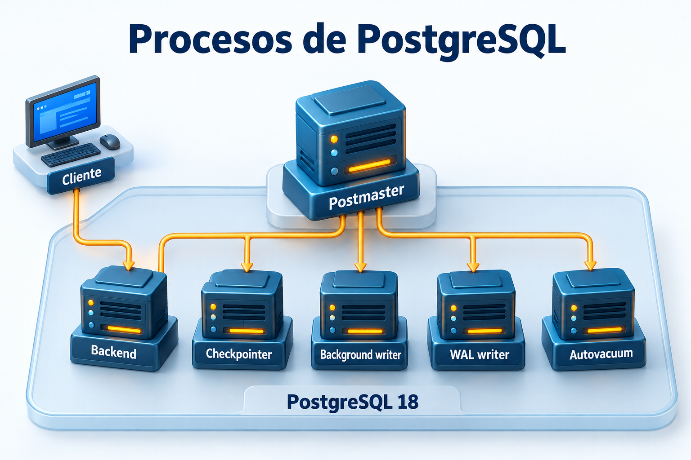
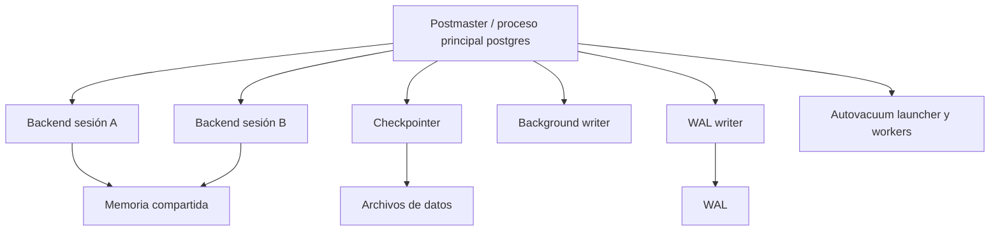

# Práctica 1.2. Explorando la Arquitectura Interna de PostgreSQL

**[⬅️ Anterior](../Practica1-1/README.md)** | **[Lista general 🗂️](../../README.md)** | **[Siguiente ➡️](../Practica1-3/README.md)**

## Objetivo de la práctica:

Al finalizar la práctica, serás capaz de:

- Identificar postmaster, checkpointer, background writer, WAL writer y autovacuum.
- Relacionar una sesión SQL con su proceso backend y su estado de espera.
- Consultar actividad y estadísticas del servidor.

## Objetivo Visual



Los bloques representan procesos de una misma instancia. El cliente tiene un backend dedicado; el bloque Autovacuum resume el launcher y sus workers de mantenimiento.



## Duración aproximada:

- 35 minutos.

## Tabla de ayuda:

| Elemento | Valor |
| --- | --- |
| Prerrequisito | 1.1 terminada; contenedor saludable |
| Sesiones | Dos terminales A y B conectadas a `curso` |
| SQL desde el equipo | `docker compose exec --user postgres debian-pg psql -X -d curso` |
| Debian desde el equipo | `docker compose exec debian-pg bash` |

## Instrucciones

### Tarea 1. Identificar procesos Linux

**Paso 1.** Desde `Capitulo01` en el equipo, abrir Debian:

```text
docker compose exec debian-pg bash
```

**Paso 2.** Ejecutar dentro de Debian:

```bash
head -n 1 /var/lib/postgresql/18/main/postmaster.pid
ps -eo pid,ppid,user,args --forest
exit
```

Relacionar el PID del archivo con el proceso principal. Los PID pertenecen al namespace del contenedor y no equivalen a los del Administrador de tareas de Windows.

**Paso 3.** Completar el PID observado de cada proceso:

| Proceso | Función | PID observado |
| --- | --- | --- |
| Postmaster | Aceptar conexiones y coordinar procesos | |
| Checkpointer | Ejecutar checkpoints y escribir páginas sucias | |
| Background writer | Escribir buffers sucios para facilitar su reutilización | |
| WAL writer | Escribir WAL pendiente; los backends también pueden escribir y sincronizar WAL | |
| Autovacuum launcher | Coordinar workers de mantenimiento | |
| Autovacuum worker | Ejecutar VACUUM y ANALYZE automáticos | |

El launcher suele estar presente; los workers aparecen durante el mantenimiento y pueden terminar antes de observarlos. PostgreSQL 18 puede mostrar procesos adicionales de I/O según plataforma y configuración.

### Tarea 2. Relacionar sesiones con backends

**Paso 1.** Abrir **dos terminales del equipo**, desde `Capitulo01`, y conectar cada una con el comando SQL de la tabla de ayuda. Ejecutar en **psql A**:

```sql
SET application_name = 'cap01_sesion_A';
SELECT pg_backend_pid() AS pid_sesion_A;
SELECT pg_sleep(30);
```

**Paso 2.** Mientras A espera, ejecutar en **psql B**:

```sql
SET application_name = 'cap01_sesion_B';
SELECT pid, backend_type, application_name, state,
       wait_event_type, wait_event, left(query, 90) AS consulta
FROM pg_stat_activity
WHERE application_name IN ('cap01_sesion_A', 'cap01_sesion_B')
ORDER BY application_name;
```

Esperar A con estado `active`, evento `PgSleep` y el PID registrado. B ejecuta la consulta de monitoreo. Si A terminó, repetir `pg_sleep(30)`.

**Paso 3.** Desde una tercera terminal del equipo:

```text
docker compose exec debian-pg ps -eo pid,ppid,user,args
```

Encontrar el proceso con el PID de A. El estado SQL `active` no significa necesariamente uso de CPU: A está esperando.

**Paso 4.** Cuando termine el sleep, repetir la consulta en B: A debe estar `idle`. Cerrar A con `\q` y consultar nuevamente en B para comprobar que su fila desapareció.

### Tarea 3. Observar estadísticas y mantenimiento

**Paso 1.** En psql B:

```sql
SELECT backend_type, count(*) AS procesos
FROM pg_stat_activity GROUP BY backend_type ORDER BY backend_type;
SHOW autovacuum;
SHOW autovacuum_naptime;
SELECT num_timed, num_requested, buffers_written FROM pg_stat_checkpointer;
SELECT buffers_clean, maxwritten_clean, buffers_alloc FROM pg_stat_bgwriter;
SELECT wal_records, wal_fpi, wal_bytes FROM pg_stat_wal;
```

Las estadísticas son acumuladas y varían por actividad de fondo. En PostgreSQL 18, consultar checkpoints en `pg_stat_checkpointer`.

**Paso 2.** Registrar `num_requested`, solicitar un checkpoint y volver a consultar:

```sql
CHECKPOINT;
SELECT pg_sleep(1);
SELECT pg_stat_clear_snapshot();
SELECT num_timed, num_requested, buffers_written FROM pg_stat_checkpointer;
```

Observar el incremento cuando se publiquen las estadísticas. Si todavía no cambia, esperar un segundo y consultar de nuevo. Los checkpoints manuales se usan aquí para demostración.

**Paso 3.** Crear y mantener una tabla de prueba:

```sql
CREATE SCHEMA IF NOT EXISTS lab_arquitectura;
DROP TABLE IF EXISTS lab_arquitectura.eventos;
CREATE TABLE lab_arquitectura.eventos (id integer, detalle text);
INSERT INTO lab_arquitectura.eventos
SELECT g, md5(g::text) FROM generate_series(1, 10000) AS g;
DELETE FROM lab_arquitectura.eventos WHERE id <= 3000;
VACUUM (VERBOSE, ANALYZE) lab_arquitectura.eventos;
SELECT count(*) AS filas FROM lab_arquitectura.eventos;
SELECT relname, n_live_tup, n_dead_tup, last_vacuum, last_analyze
FROM pg_stat_user_tables WHERE schemaname = 'lab_arquitectura';
```

Esperar 7 000 filas. `n_live_tup` y `n_dead_tup` son estimaciones; los tiempos de publicación varían. El VACUUM manual lo ejecuta el backend de la sesión y no crea un autovacuum worker.

### Resultado esperado

Identificar al menos cinco procesos, relacionar el PID de una sesión con su backend, demostrar `active` e `idle`, y registrar checkpoint y mantenimiento explícito.

## Ejercicio de análisis

Explicar la diferencia entre checkpointer y background writer, por qué autovacuum tiene launcher y workers, y por qué `pg_stat_activity` no enumera todos los procesos Linux.

## Limpieza

En psql B, eliminar únicamente la tabla de prueba y cerrar la sesión:

```sql
DROP TABLE IF EXISTS lab_arquitectura.eventos;
\q
```

## Recursos Adicionales

- [Arquitectura del servidor](https://www.postgresql.org/docs/18/tutorial-arch.html).
- [Actividad y estadísticas](https://www.postgresql.org/docs/18/monitoring-stats.html).
- [Autovacuum](https://www.postgresql.org/docs/18/routine-vacuuming.html#AUTOVACUUM).

**[⬅️ Anterior](../Practica1-1/README.md)** | **[Siguiente ➡️](../Practica1-3/README.md)**
