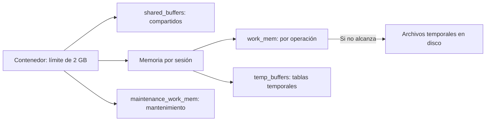

# Práctica 1.3. Análisis de Configuración y Memoria

**[⬅️ Anterior](../Practica1-2/README.md)** | **[Lista general 🗂️](../../README.md)** | **[Siguiente ➡️](../Practica1-4/README.md)**

## Objetivo de la práctica:

Al finalizar la práctica, serás capaz de:

- Distinguir shared_buffers, temp_buffers, work_mem y maintenance_work_mem.
- Observar el efecto de work_mem en una ordenación y reconocer uso de disco temporal.
- Aplicar cambios por sesión, recarga y reinicio, restaurando la configuración inicial.

## Objetivo Visual



## Duración aproximada:

- 35 minutos.

## Tabla de ayuda:

| Parámetro | Alcance | Aplicación |
| --- | --- | --- |
| shared_buffers | Memoria compartida del servidor | Reinicio |
| temp_buffers | Buffers de tablas temporales por sesión | Definir antes de usar tablas temporales |
| work_mem | Presupuesto por operación de sort/hash | SET o configuración del servidor |
| maintenance_work_mem | Operaciones de mantenimiento | SET o configuración del servidor |

## Prerrequisitos

Completar 1.1. Ejecutar Docker desde `Capitulo01` y SQL desde psql como postgres. Los valores del ejercicio corresponden a un contenedor de 2 GB; dimensionar producción según carga y concurrencia.

## Instrucciones

### Tarea 1. Inventariar parámetros

**Paso 1.** Desde el equipo:

```text
docker compose stats --no-stream
docker compose exec --user postgres debian-pg psql -X -d curso
```

**Paso 2.** En psql:

```sql
SELECT name, setting, unit, context, source, pending_restart
FROM pg_settings
WHERE name IN ('shared_buffers', 'temp_buffers', 'work_mem',
               'maintenance_work_mem', 'max_connections', 'hash_mem_multiplier')
ORDER BY name;
SHOW shared_buffers;
SHOW work_mem;
```

Registrar unidades y contexto. `pg_settings` muestra shared_buffers en bloques; `SHOW` presenta una unidad legible.

**Paso 3.** Calcular un escenario: 20 sesiones con dos ordenaciones simultáneas y work_mem de 16 MB podrían utilizar unos **640 MB solo en esas operaciones**, además de memoria compartida y otros consumos. Los hashes pueden usar `work_mem × hash_mem_multiplier`; el paralelismo también aumenta el presupuesto. Este cálculo no representa una reserva fija ni el consumo total del servidor.

### Tarea 2. Comparar ordenación en disco y en memoria

**Paso 1.** Copiar y ejecutar en psql el siguiente bloque para preparar 200 000 filas y obtener el primer plan. Una repetición reinicia solo la tabla de esta práctica:

```sql
\set ON_ERROR_STOP on
-- Reinicia únicamente los objetos de la práctica 1.3.
CREATE SCHEMA IF NOT EXISTS lab_memoria;
DROP TABLE IF EXISTS lab_memoria.ordenaciones;
CREATE TABLE lab_memoria.ordenaciones AS
SELECT g AS id, md5(g::text) || md5((g + 1)::text) AS etiqueta
FROM generate_series(1, 200000) AS g;
ANALYZE lab_memoria.ordenaciones;
SELECT count(*) AS filas FROM lab_memoria.ordenaciones;
\timing on
SET max_parallel_workers_per_gather = 0;
SET work_mem = '64kB';
EXPLAIN (ANALYZE, BUFFERS, COSTS OFF)
SELECT id, etiqueta FROM lab_memoria.ordenaciones ORDER BY etiqueta, id;
```

EXPLAIN ANALYZE ejecuta la consulta y devuelve el diagnóstico, evitando imprimir todas las filas.

**Paso 2.** Repetir con mayor memoria:

```sql
SET work_mem = '64MB';
EXPLAIN (ANALYZE, BUFFERS, COSTS OFF)
SELECT id, etiqueta FROM lab_memoria.ordenaciones ORDER BY etiqueta, id;
```

Registrar:

| Medición | work_mem 64 kB | work_mem 64 MB |
| --- | --- | --- |
| Sort Method | | |
| Disk o Memory | | |
| Buffers temporales read/written | | |
| Execution Time | | |

Esperar sort externo con 64 kB y normalmente quicksort en memoria con 64 MB. El tiempo puede cambiar por caché y equipo; evaluar método y uso de disco, sin exigir una aceleración fija.

**Paso 3.** Restaurar la sesión:

```sql
RESET work_mem;
RESET max_parallel_workers_per_gather;
```

### Tarea 3. Distinguir memoria temporal y de mantenimiento

**Paso 1.** Antes de usar la primera tabla temporal en esta sesión:

```sql
SET temp_buffers = '16MB';
CREATE TEMP TABLE temporal_memoria AS
SELECT g AS id FROM generate_series(1, 10000) AS g;
SELECT count(*) FROM temporal_memoria;
SHOW temp_buffers;
DROP TABLE temporal_memoria;
```

Esperar 10 000 filas. temp_buffers corresponde a tablas temporales, mientras work_mem controla sort/hash. Una vez utilizada la primera tabla temporal, cambiar temp_buffers no tiene efecto en esa sesión; abrir una conexión nueva para repetir.

**Paso 2.** Configurar memoria de mantenimiento y crear un índice:

```sql
SET maintenance_work_mem = '64MB';
CREATE INDEX idx_ordenaciones_id ON lab_memoria.ordenaciones(id);
\di lab_memoria.*
DROP INDEX lab_memoria.idx_ordenaciones_id;
RESET maintenance_work_mem;
```

Identificar el parámetro que corresponde a CREATE INDEX. Este paso no mide toda la memoria asignada al mantenimiento.

### Tarea 4. Aplicar recarga y reinicio

**Paso 1.** Confirmar `SHOW work_mem` y `SHOW shared_buffers` antes de cambiar valores (4 MB y 128 MB en el entorno inicial). En psql:

```sql
ALTER SYSTEM SET work_mem = '8MB';
SELECT pg_reload_conf();
\q
```

Desde el equipo, abrir una nueva conexión:

```text
docker compose exec --user postgres debian-pg psql -X -d curso
```

En psql:

```sql
SHOW work_mem;
SELECT name, setting, source, sourcefile, pending_restart
FROM pg_settings WHERE name = 'work_mem';
ALTER SYSTEM RESET work_mem;
SELECT pg_reload_conf();
\q
```

Esperar 8 MB antes del RESET y 4 MB en una conexión nueva tras restaurar. Otra conexión evita que un SET anterior de la sesión oculte el ajuste del servidor.

**Paso 2.** Abrir psql de nuevo y solicitar un cambio de memoria compartida:

```sql
ALTER SYSTEM SET shared_buffers = '256MB';
SELECT pg_reload_conf();
SELECT pg_sleep(1);
SELECT name, setting, unit, pending_restart
FROM pg_settings WHERE name = 'shared_buffers';
\q
```

El valor efectivo sigue siendo 128 MB; `pending_restart` debe ser verdadero después de procesar la recarga.

**Paso 3.** Desde el equipo:

```text
docker compose restart debian-pg
docker compose up -d --wait --wait-timeout 180
docker compose exec --user postgres debian-pg psql -X -d curso
```

En psql, confirmar 256 MB y restaurar:

```sql
SHOW shared_buffers;
ALTER SYSTEM RESET shared_buffers;
SELECT pg_reload_conf();
\q
```

**Paso 4.** Desde el equipo, reiniciar para volver a la configuración inicial:

```text
docker compose restart debian-pg
docker compose up -d --wait --wait-timeout 180
docker compose exec --user postgres debian-pg psql -X -d curso -c "SHOW shared_buffers;"
docker compose exec --user postgres debian-pg psql -X -d curso -c "SHOW work_mem;"
```

Esperar 128 MB y 4 MB. ALTER SYSTEM escribe `postgresql.auto.conf` y no se ejecuta dentro de BEGIN. Restaurar solo los parámetros modificados en el ejercicio; evitar `RESET ALL` del sistema.

### Resultado esperado

Obtener una comparación del sort, explicar los cuatro parámetros y demostrar recarga y reinicio. Entregar la tabla de mediciones y terminar con los valores iniciales del servidor.

## Ejercicio de análisis

Justificar por qué incrementar work_mem globalmente sin considerar sesiones, operaciones y workers puede agotar memoria. Proponer métricas que medir antes de cambiarlo en una aplicación real.

## Solución de Problemas

Si un parámetro conserva un valor inesperado, consultar `source` y `sourcefile` en una conexión nueva. Revisar errores con `SELECT * FROM pg_file_settings WHERE error IS NOT NULL;`. Si el sort de 64 MB aún usa disco, registrar el plan y el tamaño real del conjunto.

## Recursos Adicionales

- [Memoria y recursos del servidor](https://www.postgresql.org/docs/18/runtime-config-resource.html).
- [Aplicación y precedencia de parámetros](https://www.postgresql.org/docs/18/config-setting.html).
- [ALTER SYSTEM](https://www.postgresql.org/docs/18/sql-altersystem.html).

**[⬅️ Anterior](../Practica1-2/README.md)** | **[Siguiente ➡️](../Practica1-4/README.md)**
