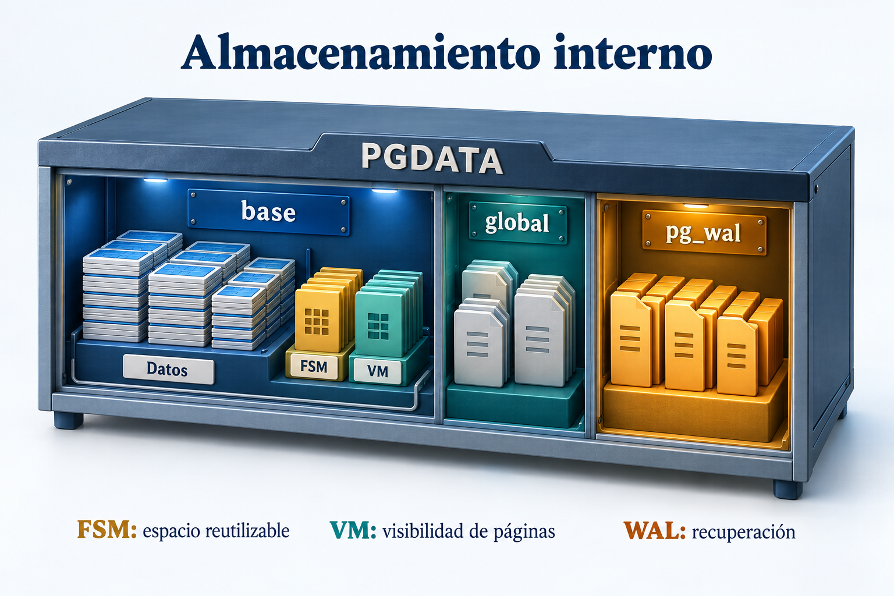
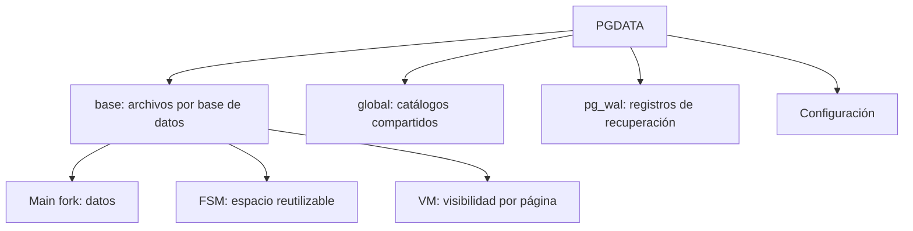

# Práctica 1.4. Explorando PGDATA y WAL

**[⬅️ Anterior](../Practica1-3/README.md)** | **[Lista general 🗂️](../../README.md)** | **[Siguiente ➡️](../Practica1-5/README.md)**

## Objetivo de la práctica:

Al finalizar la práctica, serás capaz de:

- Relacionar bases y tablas con su ubicación en PGDATA.
- Medir generación de WAL y distinguirla del tamaño de una tabla.
- Observar Free Space Map (FSM) y Visibility Map (VM) antes y después de cambios y VACUUM.

## Objetivo Visual



La ilustración destaca tres directorios de PGDATA. En el tablespace por defecto, los archivos de datos, FSM y VM de las tablas se encuentran bajo `base`; `global` contiene catálogos compartidos y `pg_wal` contiene registros de recuperación.



## Duración aproximada:

- 30 minutos.

## Tabla de ayuda:

| Elemento | Valor |
| --- | --- |
| Prerrequisito | Práctica 1.1 terminada |
| SQL desde el equipo, en `Capitulo01` | `docker compose exec --user postgres debian-pg psql -X -d curso` |
| Objetos de demostración | `lab_storage.paginas`, `lab_storage.wal_eventos` |
| Extensiones de inspección | `pg_freespacemap`, `pg_visibility` |
| PGDATA | `/var/lib/postgresql/18/main` |

## Instrucciones

### Tarea 1. Localizar datos y archivos

**Paso 1.** Entrar a psql con el comando de la tabla de ayuda y ejecutar:

```sql
SHOW data_directory;
SHOW config_file;
SHOW hba_file;
SELECT oid, datname FROM pg_database WHERE datname = current_database();
\set ON_ERROR_STOP on
-- Reinicia únicamente los objetos de la práctica 1.4.
CREATE SCHEMA IF NOT EXISTS lab_storage;
DROP TABLE IF EXISTS lab_storage.paginas;
DROP TABLE IF EXISTS lab_storage.wal_eventos;
CREATE TABLE lab_storage.paginas (
    id integer PRIMARY KEY,
    descripcion text NOT NULL
) WITH (autovacuum_enabled = false);
-- Autovacuum se desactiva solo en esta tabla de demostración para observar VM.
INSERT INTO lab_storage.paginas
SELECT g, repeat(md5(g::text), 3) FROM generate_series(1, 20000) AS g;
CREATE TABLE lab_storage.wal_eventos (id integer, detalle text);
VACUUM (ANALYZE) lab_storage.paginas;
SELECT count(*) AS filas FROM lab_storage.paginas;
SELECT pg_relation_filepath('lab_storage.paginas') AS ruta_relativa;
SELECT pg_relation_filenode('lab_storage.paginas') AS filenode;
```

El bloque anterior prepara 20 000 filas y ejecuta VACUUM. Desactiva autovacuum **solo en la tabla de demostración** para observar VM sin mantenimiento concurrente. Al repetirlo se borran únicamente las dos tablas de esta práctica.

**Paso 2.** Consultar tamaños por fork:

```sql
SELECT pg_size_pretty(pg_relation_size('lab_storage.paginas', 'main')) AS datos,
       pg_size_pretty(pg_relation_size('lab_storage.paginas', 'fsm')) AS fsm,
       pg_size_pretty(pg_relation_size('lab_storage.paginas', 'vm')) AS vm,
       pg_size_pretty(pg_total_relation_size('lab_storage.paginas')) AS total;
```

La ruta es relativa a PGDATA. El filenode no tiene que coincidir con el OID de la tabla y puede cambiar con algunas operaciones. `pg_total_relation_size` incluye índices y otros componentes.

**Paso 3.** Mantener psql abierto y, en otra terminal del equipo, abrir Debian:

```text
docker compose exec --user postgres debian-pg bash
```

Dentro de Debian:

```bash
ls -ld "$PGDATA" "$PGDATA/base" "$PGDATA/global" "$PGDATA/pg_wal"
cat "$PGDATA/PG_VERSION"
relation_path=$(psql -X -d curso -Atc "SELECT pg_relation_filepath('lab_storage.paginas');")
ls -lh "$PGDATA/$relation_path" "$PGDATA/${relation_path}_fsm" "$PGDATA/${relation_path}_vm"
exit
```

Esperar `PG_VERSION` igual a 18 y archivos main, `_fsm` y `_vm`. Inspeccionarlos mediante SQL y listados; no editar ni borrar archivos internos del servidor.

### Tarea 2. Medir WAL generado

**Paso 1.** En la sesión psql original:

```sql
TRUNCATE lab_storage.wal_eventos;
SELECT pg_current_wal_insert_lsn() AS inicio \gset
INSERT INTO lab_storage.wal_eventos
SELECT g, repeat(md5(g::text), 4) FROM generate_series(1, 10000) AS g;
SELECT pg_current_wal_insert_lsn() AS fin \gset
SELECT pg_wal_lsn_diff(:'fin'::pg_lsn, :'inicio'::pg_lsn) AS bytes_wal,
       pg_size_pretty(pg_wal_lsn_diff(:'fin'::pg_lsn, :'inicio'::pg_lsn)) AS wal_legible;
SELECT pg_walfile_name(:'fin'::pg_lsn) AS segmento;
SELECT count(*) FROM lab_storage.wal_eventos;
```

Esperar 10 000 filas y diferencia WAL positiva. La diferencia abarca toda la instancia entre las dos mediciones, incluida actividad de fondo. No es una medición exclusiva del tamaño de la tabla ni del espacio ocupado por `pg_wal`.

**Paso 2.** Consultar archivos WAL desde SQL:

```sql
SELECT name, size FROM pg_ls_waldir() ORDER BY name LIMIT 5;
SHOW wal_segment_size;
```

Un segmento suele medir 16 MB, pero comprobar el valor real. El WAL registra cambios para recuperación; un checkpoint no sustituye un respaldo y los segmentos no se eliminan manualmente.

### Tarea 3. Observar FSM y VM

**Paso 1.** En psql, instalar extensiones de inspección y registrar la línea base:

```sql
CREATE EXTENSION IF NOT EXISTS pg_freespacemap;
CREATE EXTENSION IF NOT EXISTS pg_visibility;
SELECT * FROM pg_visibility_map_summary('lab_storage.paginas');
SELECT sum(avail) AS espacio_libre_aproximado
FROM pg_freespace('lab_storage.paginas');
```

Las extensiones se utilizan aquí para inspección; el estudio general de extensiones se desarrolla en capítulos posteriores. FSM registra estimaciones de espacio reutilizable, no una suma exacta de bytes libres del disco. VM marca páginas all-visible y all-frozen.

**Paso 2.** Actualizar filas y consultar de nuevo VM:

```sql
UPDATE lab_storage.paginas SET descripcion = 'Actualizada'
WHERE id BETWEEN 1 AND 5000;
SELECT * FROM pg_visibility_map_summary('lab_storage.paginas');
```

El número de páginas all-visible debe disminuir respecto a la línea base. Las modificaciones limpian marcas de las páginas afectadas.

**Paso 3.** Eliminar filas distribuidas y registrar FSM antes y después del mantenimiento:

```sql
DELETE FROM lab_storage.paginas WHERE id % 4 = 0;
SELECT sum(avail) AS espacio_antes_vacuum
FROM pg_freespace('lab_storage.paginas');
VACUUM (ANALYZE) lab_storage.paginas;
SELECT sum(avail) AS espacio_despues_vacuum
FROM pg_freespace('lab_storage.paginas');
SELECT * FROM pg_visibility_map_summary('lab_storage.paginas');
SELECT count(*) AS filas_restantes FROM lab_storage.paginas;
ALTER TABLE lab_storage.paginas RESET (autovacuum_enabled);
```

Esperar **15 000 filas** y recuperación de marcas all-visible si no hay transacciones antiguas que impidan limpiar versiones. FSM se actualiza para reutilizar espacio; VACUUM normal no garantiza reducir el archivo de la tabla.

### Resultado esperado

Entregar rutas main/FSM/VM, bytes WAL medidos, resumen VM antes y después de UPDATE/VACUUM y conteo final de 15 000 filas. Terminar con autovacuum nuevamente habilitado.

## Ejercicio de análisis

Explicar por qué liberar espacio para reutilización no equivale a devolverlo al sistema operativo, y por qué WAL y archivos de datos tienen tamaños y funciones diferentes.

## Solución de Problemas

Si VM no recupera las marcas, cerrar sesiones con transacciones abiertas y repetir VACUUM fuera de BEGIN. Si falta una extensión, comprobar que la instalación incluye sus archivos con `SELECT name FROM pg_available_extensions WHERE name IN ('pg_visibility', 'pg_freespacemap');`.

## Limpieza

Conservar las evidencias. Eliminar solo los objetos del ejercicio, si se desea:

```sql
DROP TABLE IF EXISTS lab_storage.paginas, lab_storage.wal_eventos;
\q
```

## Recursos Adicionales

- [Organización de archivos internos](https://www.postgresql.org/docs/18/storage-file-layout.html).
- [Write-Ahead Logging](https://www.postgresql.org/docs/18/wal-intro.html).
- [Inspección de FSM](https://www.postgresql.org/docs/18/pgfreespacemap.html).
- [Inspección de VM](https://www.postgresql.org/docs/18/pgvisibility.html).

**[⬅️ Anterior](../Practica1-3/README.md)** | **[Siguiente ➡️](../Practica1-5/README.md)**
