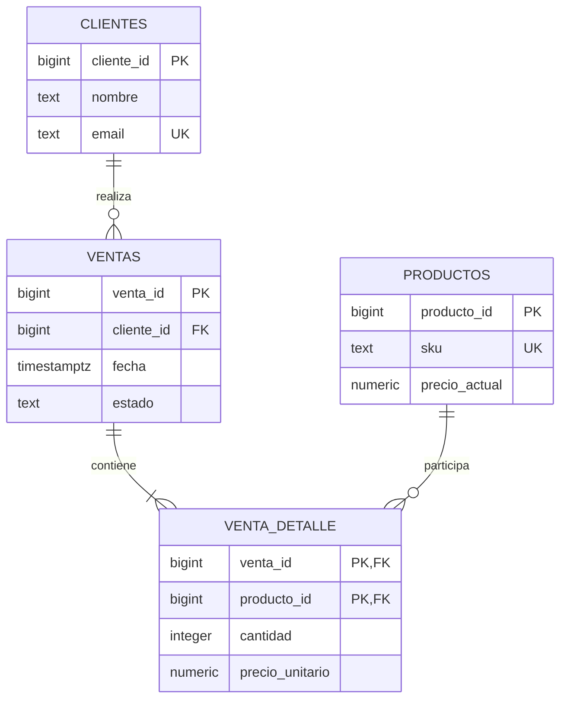

# Práctica 1.5. Diseño de una Base de Datos Empresarial

**[⬅️ Anterior](../Practica1-4/README.md)** | **[Lista general 🗂️](../../README.md)** | **[Siguiente ➡️](../Practica1-6/README.md)**

## Metadatos

| Parámetro | Detalle |
| --- | --- |
| Duración | 45 minutos |
| Complejidad | Media |
| Nivel de Taxonomía de Bloom | Crear y evaluar |
| Plataforma | Debian 13 en Docker, PostgreSQL 18 |

## Descripción General

La empresa **Comercial Netec** vende cursos y manuales. Cada venta pertenece a un cliente y contiene uno o varios productos; el precio cobrado se debe conservar aunque cambie el precio del catálogo. Diseñar un modelo relacional con claves, restricciones e índices, comprobar la integridad y preparar tablespaces para clasificar datos actuales e históricos.

Los dos volúmenes Docker permiten observar ubicaciones diferentes. En una estación de trabajo pueden residir en el mismo disco: esta separación lógica no demuestra diferentes velocidades, alta disponibilidad ni aislamiento físico de fallos.

## Objetivos de Aprendizaje

Al finalizar la práctica, serás capaz de:

- Identificar entidades y relaciones, y justificar un modelo en tercera forma normal.
- Implementar claves primarias y foráneas, restricciones de unicidad y validaciones de negocio.
- Conservar precios históricos y calcular totales sin duplicar datos derivados.
- Crear tablespaces con permisos del usuario postgres y comprobar la ubicación de tablas.

## Objetivo Visual



El modelo lógico requiere al menos un detalle por venta. Las claves foráneas por sí solas no exigen ese mínimo: una aplicación debe insertar cabecera y detalles en una transacción y validar la regla al confirmar. La vista de totales incluye ventas con detalle.

## Prerrequisitos

Completar 1.1, conocer DDL y JOIN, y ejecutar Docker desde `Capitulo01`. El usuario administrador del laboratorio es `postgres` en la base `curso`. El entorno ya monta los volúmenes de tablespaces; no crear un servidor adicional.

## Entorno de Laboratorio

| Elemento | Valor |
| --- | --- |
| Servicio Compose | `debian-pg` |
| Base / esquema de negocio | `curso` / `empresa` |
| Tablespace actual | `ts_hot` → `/srv/pg-tablespaces/hot` |
| Tablespace histórico | `ts_cold` → `/srv/pg-tablespaces/cold` |
| Preparación | Bloque SQL de la tarea 3, paso 2 |
| Pruebas | Bloque SQL de la tarea 4, paso 1 |

## Instrucciones Paso a Paso

### Tarea 1. Analizar requerimientos y decisiones

**Paso 1.** Leer las reglas del negocio:

1. Cada cliente tiene un email único y un nombre no vacío.
2. Cada producto tiene SKU único y precio de catálogo positivo.
3. Una venta pertenece a un cliente existente, tiene fecha con zona horaria y estado controlado.
4. Cada producto aparece como máximo una vez por venta, con cantidad positiva y precio cobrado positivo.
5. El total se calcula a partir de sus detalles, y todos los importes usan la misma moneda del caso de estudio.

**Paso 2.** Documentar por qué el precio del detalle y el del catálogo son atributos distintos. Usar `numeric`, en lugar de coma flotante, para importes; usar `timestamptz` para instantes. El entorno muestra fechas en UTC.

**Paso 3.** Verificar que nombres y datos del cliente no se repiten en cada venta y que la relación N:M entre ventas y productos se resuelve mediante `venta_detalle`. Justificar qué dependencias elimina este diseño para aproximarse a 3FN.

### Tarea 2. Preparar tablespaces

**Paso 1.** Desde el equipo, revisar permisos y volúmenes:

```text
docker compose exec debian-pg ls -ld /srv/pg-tablespaces/hot /srv/pg-tablespaces/cold
docker compose config --volumes
```

Esperar propietario `postgres` y directorios con permisos restrictivos. El entrypoint los prepara sin asumir un UID fijo y sin permisos universales.

**Paso 2.** Desde el equipo, abrir psql:

```text
docker compose exec --user postgres debian-pg psql -X -d curso
```

En psql, crear solo los tablespaces que todavía no existan:

```sql
SELECT 'CREATE TABLESPACE ts_hot LOCATION ''/srv/pg-tablespaces/hot'''
WHERE NOT EXISTS (SELECT 1 FROM pg_tablespace WHERE spcname = 'ts_hot')
\gexec
SELECT 'CREATE TABLESPACE ts_cold LOCATION ''/srv/pg-tablespaces/cold'''
WHERE NOT EXISTS (SELECT 1 FROM pg_tablespace WHERE spcname = 'ts_cold')
\gexec
SELECT spcname, pg_tablespace_location(oid) AS ubicacion
FROM pg_tablespace WHERE spcname IN ('ts_hot', 'ts_cold');
\db
```

No usar BEGIN para CREATE TABLESPACE. Los directorios de un tablespace nuevo deben estar vacíos y pertenecer al usuario del servidor. Si ya existen, comprobar que apuntan a las rutas esperadas.

### Tarea 3. Implementar el modelo y cargar datos

**Paso 1.** Revisar el bloque SQL del paso siguiente. Identificar PRIMARY KEY, FOREIGN KEY, UNIQUE, CHECK, tipos y TABLESPACE. Comparar el código con el diagrama.

**Paso 2.** Copiar y ejecutar el siguiente bloque completo en psql:

```sql
\set ON_ERROR_STOP on
-- Reinicia las cuatro tablas y la vista del esquema empresa.
-- Ejecutar antes de la carga 1.6; una repetición borra también sus ventas masivas.
CREATE SCHEMA IF NOT EXISTS empresa;
DROP VIEW IF EXISTS empresa.v_totales_ventas;
DROP TABLE IF EXISTS empresa.venta_detalle;
DROP TABLE IF EXISTS empresa.ventas;
DROP TABLE IF EXISTS empresa.productos;
DROP TABLE IF EXISTS empresa.clientes;

BEGIN;
CREATE TABLE empresa.clientes (
    cliente_id bigint GENERATED ALWAYS AS IDENTITY PRIMARY KEY,
    nombre text NOT NULL CHECK (btrim(nombre) <> ''),
    email text NOT NULL UNIQUE,
    creado_en timestamptz NOT NULL DEFAULT CURRENT_TIMESTAMP
) TABLESPACE ts_hot;

CREATE TABLE empresa.productos (
    producto_id bigint GENERATED ALWAYS AS IDENTITY PRIMARY KEY,
    sku text NOT NULL UNIQUE,
    nombre text NOT NULL,
    precio_actual numeric(12,2) NOT NULL CHECK (precio_actual > 0),
    activo boolean NOT NULL DEFAULT true
) TABLESPACE ts_hot;

CREATE TABLE empresa.ventas (
    venta_id bigint GENERATED ALWAYS AS IDENTITY PRIMARY KEY,
    cliente_id bigint NOT NULL REFERENCES empresa.clientes(cliente_id),
    fecha timestamptz NOT NULL,
    estado text NOT NULL CHECK (estado IN ('pendiente', 'pagada', 'cancelada'))
) TABLESPACE ts_hot;

CREATE TABLE empresa.venta_detalle (
    venta_id bigint NOT NULL REFERENCES empresa.ventas(venta_id),
    producto_id bigint NOT NULL REFERENCES empresa.productos(producto_id),
    cantidad integer NOT NULL CHECK (cantidad > 0),
    precio_unitario numeric(12,2) NOT NULL CHECK (precio_unitario > 0),
    PRIMARY KEY (venta_id, producto_id)
) TABLESPACE ts_hot;

-- PostgreSQL no crea automáticamente índices en las columnas que referencian una FK.
CREATE INDEX idx_ventas_cliente_fecha ON empresa.ventas(cliente_id, fecha);
CREATE INDEX idx_detalle_producto ON empresa.venta_detalle(producto_id);
CREATE VIEW empresa.v_totales_ventas AS
SELECT v.venta_id, v.cliente_id, v.fecha, v.estado,
       sum(d.cantidad * d.precio_unitario)::numeric(14,2) AS total
FROM empresa.ventas v JOIN empresa.venta_detalle d USING (venta_id)
GROUP BY v.venta_id;

INSERT INTO empresa.clientes(nombre, email)
VALUES ('Ana Torres', 'ana@example.test'), ('Luis Pérez', 'luis@example.test');
INSERT INTO empresa.productos(sku, nombre, precio_actual)
VALUES ('CURSO-SQL', 'Curso de SQL', 500.00), ('MANUAL-PG', 'Manual de PostgreSQL', 150.00);
INSERT INTO empresa.ventas(cliente_id, fecha, estado)
VALUES (1, '2026-01-15 10:00:00+00', 'pagada'),
       (2, '2026-04-20 12:00:00+00', 'pagada');
INSERT INTO empresa.venta_detalle VALUES (1, 1, 1, 500.00), (1, 2, 2, 150.00), (2, 2, 1, 150.00);
COMMIT;
SELECT * FROM empresa.v_totales_ventas ORDER BY venta_id;
\dt empresa.*
\d+ empresa.ventas
\d+ empresa.venta_detalle
\di empresa.*
```

El bloque reinicia cuatro tablas y una vista del esquema `empresa`; repetirlo devuelve los datos a su estado inicial. Si ya existe la práctica 1.6, eliminar primero sus tablas dependientes conforme a su sección de limpieza.

Esperar **dos clientes, dos productos, dos ventas y tres detalles**. Los índices facilitan el acceso por cliente/fecha y por producto. PostgreSQL crea índices para PRIMARY KEY y UNIQUE, pero no automáticamente para las columnas que referencian una FK.

**Paso 3.** Consultar la venta y comprobar su total:

```sql
SELECT c.nombre, v.venta_id, v.fecha, v.total
FROM empresa.v_totales_ventas v
JOIN empresa.clientes c USING (cliente_id)
ORDER BY v.venta_id;
```

| Cliente | Venta | Total esperado |
| --- | --- | --- |
| Ana Torres | 1 | 800.00 |
| Luis Pérez | 2 | 150.00 |

**Paso 4.** Validar precios históricos en una transacción que se revierte:

```sql
BEGIN;
UPDATE empresa.productos SET precio_actual = 175.00 WHERE producto_id = 2;
SELECT precio_actual FROM empresa.productos WHERE producto_id = 2;
SELECT venta_id, precio_unitario FROM empresa.venta_detalle WHERE producto_id = 2;
SELECT venta_id, total FROM empresa.v_totales_ventas ORDER BY venta_id;
ROLLBACK;
```

El catálogo muestra 175.00 durante la prueba, mientras los detalles conservan 150.00 y los totales 800.00 y 150.00. ROLLBACK restaura el catálogo.

### Tarea 4. Comprobar integridad y almacenamiento

**Paso 1.** Ejecutar en psql el siguiente bloque de pruebas:

```sql
\set ON_ERROR_STOP on
-- Cada error esperado se captura en una subtransacción; no persisten datos de prueba.
DO $$
BEGIN
    BEGIN
        INSERT INTO empresa.clientes(nombre, email) VALUES ('Duplicado', 'ana@example.test');
        RAISE EXCEPTION 'FALLO: se permitió un email duplicado';
    EXCEPTION WHEN unique_violation THEN
        RAISE NOTICE 'OK: email duplicado rechazado (23505)';
    END;
    BEGIN
        INSERT INTO empresa.ventas(cliente_id, fecha, estado) VALUES (-1, CURRENT_TIMESTAMP, 'pagada');
        RAISE EXCEPTION 'FALLO: se permitió una venta huérfana';
    EXCEPTION WHEN foreign_key_violation THEN
        RAISE NOTICE 'OK: venta huérfana rechazada (23503)';
    END;
    BEGIN
        INSERT INTO empresa.venta_detalle VALUES (1, 2, 0, 150.00);
        RAISE EXCEPTION 'FALLO: se permitió cantidad cero';
    EXCEPTION WHEN check_violation THEN
        RAISE NOTICE 'OK: cantidad cero rechazada (23514)';
    END;
    IF (SELECT total FROM empresa.v_totales_ventas WHERE venta_id = 1) IS DISTINCT FROM 800.00
       OR (SELECT total FROM empresa.v_totales_ventas WHERE venta_id = 2) IS DISTINCT FROM 150.00 THEN
        RAISE EXCEPTION 'Totales de ventas incorrectos';
    END IF;
    IF EXISTS (SELECT 1 FROM empresa.ventas v LEFT JOIN empresa.clientes c USING (cliente_id)
               WHERE c.cliente_id IS NULL) THEN
        RAISE EXCEPTION 'Se encontraron ventas huérfanas';
    END IF;
    RAISE NOTICE 'OK: totales 800.00 y 150.00; sin ventas huérfanas';
END $$;
```

Esperar mensajes `OK` para email duplicado rechazado, venta huérfana rechazada, cantidad cero rechazada y totales correctos. Cada fallo esperado se captura sin dejar datos de prueba. Las secuencias de identidad pueden presentar saltos después de errores; no son una numeración contable.

**Paso 2.** Comprobar la ubicación de las tablas:

```sql
SELECT c.relname, t.spcname, pg_relation_filepath(c.oid) AS archivo,
       pg_size_pretty(pg_total_relation_size(c.oid)) AS tamano
FROM pg_class c
JOIN pg_namespace n ON n.oid = c.relnamespace
JOIN pg_tablespace t ON t.oid = c.reltablespace
WHERE n.nspname = 'empresa' AND c.relkind = 'r'
ORDER BY c.relname;
```

Esperar las cuatro tablas en `ts_hot`, con rutas bajo `pg_tblspc`. Los índices usan el tablespace por defecto si no se especifica otro: asignar TABLESPACE a una tabla no mueve automáticamente todos sus índices.

## Validación y Pruebas

### Resultado esperado

Modelo relacional operativo, cuatro tablas y una vista, totales comprobados y tres reglas de integridad verificadas. Entregar diagrama, decisiones de tipos/normalización, resultados de pruebas y ubicación de las tablas.

### Ejercicio de análisis

Proponer cómo admitir varias líneas del mismo producto con distintos descuentos. Explicar qué clave sustituiría `(venta_id, producto_id)` y qué reglas e índices se modificarían. Diseñar la solución antes de aplicarla.

## Solución de Problemas

| Síntoma | Solución |
| --- | --- |
| `permission denied` al crear tablespace | Confirmar propietario postgres y ruta dentro del contenedor; usar los volúmenes de Compose |
| `directory ... is not empty` | Revisar si el tablespace ya está creado y su ubicación; no borrar archivos del servidor |
| Dependencias al repetir el modelo | Limpiar primero los objetos `lab_volumen` de 1.6 |
| `current transaction is aborted` en una prueba manual | Ejecutar ROLLBACK; utilizar el bloque de validación que captura los fallos esperados |

## Limpieza

Conservar `empresa`, `ts_hot` y `ts_cold` para 1.6. Salir de psql con `\q`. La limpieza total del proyecto está en la [guía del capítulo](../README.md#limpieza).

## Resumen

El modelo separa catálogo, cabecera y detalle, preserva precios históricos y utiliza restricciones verificables. Los tablespaces permiten decidir ubicaciones; su rendimiento depende del almacenamiento subyacente.

## Recursos Adicionales

- [Restricciones e integridad referencial](https://www.postgresql.org/docs/18/ddl-constraints.html).
- [CREATE TABLE](https://www.postgresql.org/docs/18/sql-createtable.html).
- [Tablespaces](https://www.postgresql.org/docs/18/manage-ag-tablespaces.html).
- [Tipos numéricos](https://www.postgresql.org/docs/18/datatype-numeric.html).

**[⬅️ Anterior](../Practica1-4/README.md)** | **[Siguiente ➡️](../Practica1-6/README.md)**
