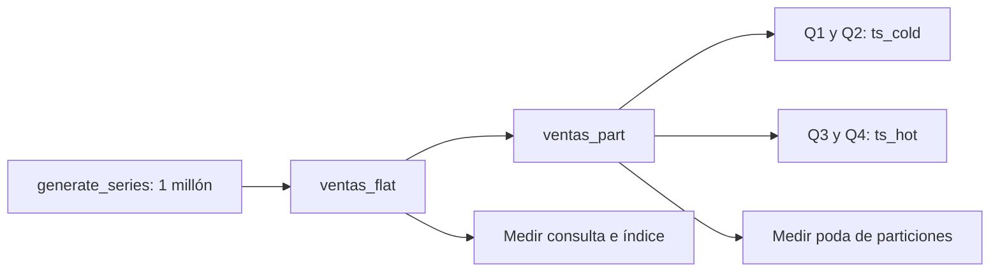

# Práctica 1.6. Grandes Volúmenes de Información

**[⬅️ Anterior](../Practica1-5/README.md)** | **[Lista general 🗂️](../../README.md)** | **[Capítulo 1](../README.md)**

## Metadatos

| Parámetro | Detalle |
| --- | --- |
| Duración | 30 minutos; retos adicionales fuera del tiempo guiado |
| Complejidad | Media |
| Nivel de Taxonomía de Bloom | Analizar y evaluar |
| Plataforma | Debian 13 en Docker, PostgreSQL 18 |

## Descripción General

Comercial Netec necesita almacenar y consultar ventas históricas. Generar **un millón de registros deterministas**, comparar una tabla convencional con otra particionada y medir el efecto de un índice selectivo. El ejercicio introduce decisiones de almacenamiento y procesamiento; el particionamiento y los índices especializados se profundizan en capítulos posteriores.

Los volúmenes hot/cold representan una clasificación didáctica por período. Los tiempos dependen de CPU, disco, memoria, estadísticas y caché; registrar los obtenidos en el equipo.

## Objetivos de Aprendizaje

Al finalizar la práctica, serás capaz de:

- Generar datos mediante operaciones de conjuntos y verificar sus conteos.
- Distribuir registros por rangos de fecha y comprobar poda de particiones.
- Comparar consultas antes y después de crear un índice, usando EXPLAIN ANALYZE y BUFFERS.
- Registrar tamaños y justificar una estrategia para escalar volumen sin sacrificar integridad.

## Objetivo Visual



## Prerrequisitos

Completar 1.5: deben existir `empresa.clientes` con IDs 1 y 2, y los tablespaces `ts_hot` y `ts_cold`. Disponer de espacio libre para **dos copias** de los datos más índices, WAL y archivos temporales. Usar el mismo contenedor; ejecutar Docker desde `Capitulo01`.

## Entorno de Laboratorio

| Elemento | Valor |
| --- | --- |
| Base / esquema | `curso` / `lab_volumen` |
| Carga guiada | 1 000 000 filas; 10 000 fallidas (1 %) |
| Fechas | Año 2026, límites en UTC |
| Tablas | `ventas_flat`, `ventas_part` y cuatro particiones trimestrales |
| Preparación | Bloque SQL de la tarea 1, paso 2 |
| Validación | Bloque SQL de la tarea 4, paso 1 |

## Instrucciones Paso a Paso

### Tarea 1. Preparar y verificar el volumen

**Paso 1.** Desde el equipo, abrir psql:

```text
docker compose exec --user postgres debian-pg psql -X -d curso
```

En psql, comprobar los prerrequisitos:

```sql
SELECT cliente_id, nombre FROM empresa.clientes ORDER BY cliente_id;
SELECT spcname, pg_tablespace_location(oid)
FROM pg_tablespace WHERE spcname IN ('ts_hot', 'ts_cold');
```

**Paso 2.** Revisar y ejecutar el siguiente bloque completo en psql. Si alguna comprobación produce un error, resolverlo antes de continuar con la carga:

```sql
\set filas 1000000
\set ON_ERROR_STOP on
\timing on
SET TIME ZONE 'UTC';
-- Volumen predeterminado: un millón; el reto permite cinco millones.
\if :{?filas}
\else
\set filas 1000000
\endif
SELECT :filas::bigint BETWEEN 1000 AND 5000000 AS volumen_valido \gset
\if :volumen_valido
\else
\echo 'Usar un valor entero entre 1000 y 5000000 para filas.'
-- Con ON_ERROR_STOP, abortar con un error SQL antes de modificar objetos.
SELECT 1 / 0;
\endif

-- Verificar dependencias antes de reemplazar datos de una ejecución anterior.
DO $$
BEGIN
    IF to_regclass('empresa.clientes') IS NULL THEN
        RAISE EXCEPTION 'Completar la práctica 1.5: falta empresa.clientes';
    END IF;
    IF (SELECT count(*) FROM empresa.clientes WHERE cliente_id IN (1, 2)) <> 2 THEN
        RAISE EXCEPTION 'Completar la práctica 1.5: se requieren clientes 1 y 2';
    END IF;
    IF (SELECT count(*) FROM pg_tablespace WHERE spcname IN ('ts_hot', 'ts_cold')) <> 2 THEN
        RAISE EXCEPTION 'Completar la práctica 1.5: faltan tablespaces';
    END IF;
END $$;

-- Preparar únicamente objetos de lab_volumen, sin borrar el modelo empresarial.
CREATE SCHEMA IF NOT EXISTS lab_volumen;
DROP TABLE IF EXISTS lab_volumen.ventas_part;
DROP TABLE IF EXISTS lab_volumen.ventas_flat;
CREATE TABLE lab_volumen.ventas_flat (
    venta_id bigint PRIMARY KEY,
    cliente_id bigint NOT NULL REFERENCES empresa.clientes(cliente_id),
    fecha timestamptz NOT NULL,
    monto numeric(12,2) NOT NULL CHECK (monto > 0),
    estado text NOT NULL CHECK (estado IN ('pagada', 'fallida'))
) TABLESPACE ts_hot;

INSERT INTO lab_volumen.ventas_flat
SELECT g,
       1 + (g % 2),
       timestamptz '2026-01-01 00:00:00+00'
         + ((g - 1) % 365) * interval '1 day'
         + ((g - 1) % 86400) * interval '1 second',
       (50 + (g % 1000) * 1.50)::numeric(12,2),
       CASE WHEN g % 100 = 0 THEN 'fallida' ELSE 'pagada' END
FROM generate_series(1, :filas::bigint) AS g;

CREATE TABLE lab_volumen.ventas_part (
    venta_id bigint NOT NULL,
    cliente_id bigint NOT NULL REFERENCES empresa.clientes(cliente_id),
    fecha timestamptz NOT NULL,
    monto numeric(12,2) NOT NULL CHECK (monto > 0),
    estado text NOT NULL CHECK (estado IN ('pagada', 'fallida')),
    PRIMARY KEY (venta_id, fecha)
) PARTITION BY RANGE (fecha);
CREATE TABLE lab_volumen.ventas_2026_q1 PARTITION OF lab_volumen.ventas_part
    FOR VALUES FROM ('2026-01-01 00:00:00+00') TO ('2026-04-01 00:00:00+00') TABLESPACE ts_cold;
CREATE TABLE lab_volumen.ventas_2026_q2 PARTITION OF lab_volumen.ventas_part
    FOR VALUES FROM ('2026-04-01 00:00:00+00') TO ('2026-07-01 00:00:00+00') TABLESPACE ts_cold;
CREATE TABLE lab_volumen.ventas_2026_q3 PARTITION OF lab_volumen.ventas_part
    FOR VALUES FROM ('2026-07-01 00:00:00+00') TO ('2026-10-01 00:00:00+00') TABLESPACE ts_hot;
CREATE TABLE lab_volumen.ventas_2026_q4 PARTITION OF lab_volumen.ventas_part
    FOR VALUES FROM ('2026-10-01 00:00:00+00') TO ('2027-01-01 00:00:00+00') TABLESPACE ts_hot;
INSERT INTO lab_volumen.ventas_part SELECT * FROM lab_volumen.ventas_flat;
VACUUM (ANALYZE) lab_volumen.ventas_flat;
VACUUM (ANALYZE) lab_volumen.ventas_part;
SELECT count(*) AS filas, count(*) FILTER (WHERE estado = 'fallida') AS fallidas
FROM lab_volumen.ventas_flat;
SELECT tableoid::regclass AS particion, count(*) AS filas
FROM lab_volumen.ventas_part GROUP BY tableoid ORDER BY particion;
```

El bloque borra y reconstruye solo `lab_volumen.ventas_flat`, `ventas_part` y sus particiones. Genera el conjunto una vez y lo copia a la tabla particionada. Activa medición de tiempos y ejecuta VACUUM ANALYZE fuera de una transacción explícita.

La PK de la tabla particionada es `(venta_id, fecha)`: PostgreSQL exige incluir la clave de partición para una restricción de unicidad sobre toda esa tabla. Esta clave no garantiza que `venta_id` sea único por sí solo entre fechas; el generador produce IDs únicos en este caso.

**Paso 3.** Verificar:

```sql
SELECT count(*) AS filas,
       count(*) FILTER (WHERE estado = 'fallida') AS fallidas
FROM lab_volumen.ventas_flat;
SELECT tableoid::regclass AS particion, count(*) AS filas
FROM lab_volumen.ventas_part GROUP BY tableoid ORDER BY particion;
```

Esperar **1 000 000 filas y 10 000 fallidas**. Las cuatro particiones suman un millón; no tienen exactamente el mismo conteo porque los trimestres tienen distinta cantidad de días.

### Tarea 2. Comparar tabla completa y poda de particiones

**Paso 1.** En la misma sesión, desactivar paralelismo para simplificar la lectura del plan y ejecutar:

```sql
SET max_parallel_workers_per_gather = 0;
EXPLAIN (ANALYZE, BUFFERS, COSTS OFF)
SELECT count(*), sum(monto)
FROM lab_volumen.ventas_flat
WHERE fecha >= timestamptz '2026-01-01 00:00:00+00'
  AND fecha <  timestamptz '2026-04-01 00:00:00+00';

EXPLAIN (ANALYZE, BUFFERS, COSTS OFF)
SELECT count(*), sum(monto)
FROM lab_volumen.ventas_part
WHERE fecha >= timestamptz '2026-01-01 00:00:00+00'
  AND fecha <  timestamptz '2026-04-01 00:00:00+00';
```

En la tabla particionada, esperar acceso solo a `ventas_2026_q1`, debido a los límites constantes. La tabla plana debe examinar registros de todo el año para aplicar el filtro. Comprobar conteo y suma iguales con SELECT si es necesario.

**Paso 2.** Desactivar poda temporalmente y volver a ejecutar la segunda consulta EXPLAIN:

```sql
SET enable_partition_pruning = off;
EXPLAIN (ANALYZE, BUFFERS, COSTS OFF)
SELECT count(*), sum(monto)
FROM lab_volumen.ventas_part
WHERE fecha >= timestamptz '2026-01-01 00:00:00+00'
  AND fecha <  timestamptz '2026-04-01 00:00:00+00';
```

Observar que el plan incluye las otras particiones, aunque sus filtros no devuelvan filas. El planner puede usar diferentes formas de acceso; no evaluar el laboratorio por un único nombre de nodo.

**Paso 3.** Restaurar:

```sql
RESET enable_partition_pruning;
RESET max_parallel_workers_per_gather;
```

Usar intervalos semiabiertos `[inicio, fin)` evita solapamientos. Las funciones estables y parámetros pueden permitir poda durante ejecución; no asumir que toda expresión dinámica anula el particionamiento.

### Tarea 3. Evaluar acceso selectivo e índices

**Paso 1.** Obtener la línea base para búsquedas de un cliente por fecha:

```sql
EXPLAIN (ANALYZE, BUFFERS, COSTS OFF)
SELECT * FROM lab_volumen.ventas_flat
WHERE cliente_id = 1
  AND fecha >= timestamptz '2026-05-10 00:00:00+00'
  AND fecha <  timestamptz '2026-05-11 00:00:00+00';
```

**Paso 2.** Crear un índice B-tree y repetir exactamente la consulta anterior:

```sql
CREATE INDEX idx_flat_cliente_fecha
ON lab_volumen.ventas_flat(cliente_id, fecha);
ANALYZE lab_volumen.ventas_flat;
```

Esperar normalmente acceso por índice o bitmap al subconjunto. Si el optimizador elige otro plan, registrar selectividad, estadísticas y configuración; no forzar un plan para obtener un resultado predeterminado.

**Paso 3.** Crear un índice parcial sobre el 1 % de fallos y consultar:

```sql
CREATE INDEX idx_flat_fallidas ON lab_volumen.ventas_flat(fecha)
WHERE estado = 'fallida';
EXPLAIN (ANALYZE, BUFFERS, COSTS OFF)
SELECT count(*) FROM lab_volumen.ventas_flat WHERE estado = 'fallida';
SELECT indexrelid::regclass AS indice,
       pg_size_pretty(pg_relation_size(indexrelid)) AS tamano
FROM pg_index WHERE indrelid = 'lab_volumen.ventas_flat'::regclass
ORDER BY pg_relation_size(indexrelid) DESC;
```

El resultado del conteo es 10 000. El índice parcial debe ser menor que un índice que incluya todas las filas; el plan y Heap Fetches dependen también de VM. Cada índice consume espacio y añade trabajo a las escrituras.

### Tarea 4. Validar resultados y presentar mediciones

**Paso 1.** Ejecutar en psql el siguiente bloque de validación:

```sql
\set ON_ERROR_STOP on
\if :{?filas}
\else
\set filas 1000000
\endif
SELECT count(*) = :filas::bigint AS conteo_correcto,
       count(*) FILTER (WHERE estado = 'fallida') = :filas::bigint / 100 AS fallidas_correctas
FROM lab_volumen.ventas_flat \gset
SELECT :'conteo_correcto'::boolean AS conteo_correcto,
       :'fallidas_correctas'::boolean AS fallidas_correctas;
\if :conteo_correcto
\else
\echo 'ERROR: el total de filas no coincide con el volumen solicitado.'
SELECT 1 / 0;
\endif
\if :fallidas_correctas
\else
\echo 'ERROR: el conteo de filas fallidas no coincide con la distribución esperada.'
SELECT 1 / 0;
\endif
SELECT NOT EXISTS (
    (SELECT * FROM lab_volumen.ventas_flat EXCEPT ALL SELECT * FROM lab_volumen.ventas_part)
    UNION ALL
    (SELECT * FROM lab_volumen.ventas_part EXCEPT ALL SELECT * FROM lab_volumen.ventas_flat)
) AS conjuntos_identicos \gset
SELECT :'conjuntos_identicos'::boolean AS conjuntos_identicos;
\if :conjuntos_identicos
\else
\echo 'ERROR: las dos representaciones no contienen los mismos registros.'
SELECT 1 / 0;
\endif
SELECT c.relname, pg_size_pretty(pg_total_relation_size(c.oid)) AS espacio_total
FROM pg_class c JOIN pg_namespace n ON n.oid = c.relnamespace
WHERE n.nspname = 'lab_volumen' AND c.relkind = 'r' ORDER BY c.relname;
```

Esperar `t` en `conteo_correcto`, `fallidas_correctas` y `conjuntos_identicos`. La comprobación bidireccional con EXCEPT ALL verifica que ambas tablas contienen el mismo conjunto y la misma multiplicidad; sus conteos iguales por sí solos no bastan.

**Paso 2.** Registrar resultados reales:

| Escenario | Filas devueltas | Relaciones examinadas | Buffers hit/read | Tiempo |
| --- | --- | --- | --- | --- |
| Tabla plana, trimestre 1 | | | | |
| Particionada, poda activa | | | | |
| Particionada, poda desactivada | | | | |
| Cliente/día sin índice | | | | |
| Cliente/día con índice | | | | |

Repetir una consulta puede calentar caché. Explicar esa limitación al comparar tiempos; no atribuir toda diferencia a un único cambio.

## Validación y Pruebas

### Resultado esperado

Un millón de filas en cada representación, 10 000 fallidas, datos idénticos, poda demostrada y medición de acceso selectivo. Entregar los planes, la tabla comparativa y tamaños reales.

### Prueba de fecha sin partición

En psql, usar una subtransacción que capture el fallo esperado:

```sql
DO $$
BEGIN
    BEGIN
        INSERT INTO lab_volumen.ventas_part
        VALUES (-1, 1, '2027-01-01 00:00:00+00', 100.00, 'pagada');
        RAISE EXCEPTION 'FALLO: se aceptó fecha sin partición';
    EXCEPTION WHEN check_violation THEN
        RAISE NOTICE 'OK: fecha fuera de las particiones rechazada';
    END;
END $$;
```

Diseñar la creación anticipada de próximas particiones. Una partición DEFAULT puede evitar rechazos, pero requiere una política de revisión y mantenimiento.

## Ejercicios adicionales

Fuera de los 30 minutos guiados:

1. Repetir la carga con `\set filas 5000000`, tras comprobar espacio libre. La carga reemplaza los objetos del ejercicio y los índices deben crearse de nuevo. Esperar cinco millones de filas y 50 000 fallidas; usar el mismo valor de `filas` al validar.
2. Explorar BRIN sobre una copia físicamente ordenada. Ejecutar en psql:

```sql
DROP TABLE IF EXISTS lab_volumen.ventas_brin;
CREATE TABLE lab_volumen.ventas_brin AS
SELECT * FROM lab_volumen.ventas_flat ORDER BY fecha, venta_id;
CREATE INDEX idx_brin_fecha ON lab_volumen.ventas_brin
USING brin(fecha) WITH (pages_per_range = 64);
ANALYZE lab_volumen.ventas_brin;
SELECT correlation FROM pg_stats
WHERE schemaname = 'lab_volumen' AND tablename = 'ventas_brin' AND attname = 'fecha';
EXPLAIN (ANALYZE, BUFFERS, COSTS OFF)
SELECT sum(monto) FROM lab_volumen.ventas_brin
WHERE fecha >= timestamptz '2026-05-10 00:00:00+00'
  AND fecha <  timestamptz '2026-05-11 00:00:00+00';
SELECT pg_size_pretty(pg_relation_size('lab_volumen.idx_brin_fecha'));
```

BRIN resume rangos de páginas y devuelve candidatos que deben verificarse. La copia ordenada facilita correlación; la tabla original generada no está ordenada por fecha. El optimizador puede preferir escaneo secuencial según selectividad y costos.

## Solución de Problemas

| Síntoma | Solución |
| --- | --- |
| Falta `empresa.clientes` o un tablespace | Completar 1.5 en este mismo proyecto |
| Interrupción por memoria o disco | Revisar recursos, cerrar otras cargas y repetir con `\set filas 100000` |
| No se utiliza un índice | Revisar ANALYZE, selectividad y plan; un índice no garantiza una elección concreta |
| El total incluye otras prácticas | Filtrar el esquema `lab_volumen`; no sumar todas las tablas de `curso` |
| Dependencias al repetir 1.5 | Limpiar primero los objetos de volumen de esta práctica |

## Limpieza

Conservar los datos si se usarán como evidencia o en prácticas posteriores. Para eliminar solo el volumen de demostración, ejecutar en psql:

```sql
DROP TABLE IF EXISTS lab_volumen.ventas_brin;
DROP TABLE IF EXISTS lab_volumen.ventas_part;
DROP TABLE IF EXISTS lab_volumen.ventas_flat;
\q
```

DROP TABLE libera sus archivos e índices; no se necesita ejecutar VACUUM FULL de toda la base después. Conservar el modelo empresarial y los volúmenes de Docker.

## Resumen

La carga por conjuntos, estadísticas, filtros temporales y acceso selectivo permiten evaluar decisiones de escalamiento. Particionar ayuda a organizar y descartar períodos; medir su efecto antes de adoptarlo.

## Recursos Adicionales

- [Carga de datos y estadísticas](https://www.postgresql.org/docs/18/populate.html).
- [Particionamiento declarativo y poda](https://www.postgresql.org/docs/18/ddl-partitioning.html).
- [EXPLAIN](https://www.postgresql.org/docs/18/using-explain.html).
- [Índices parciales](https://www.postgresql.org/docs/18/indexes-partial.html).
- [Índices BRIN](https://www.postgresql.org/docs/18/brin.html).

**[⬅️ Anterior](../Practica1-5/README.md)** | **[Lista general 🗂️](../../README.md)**
