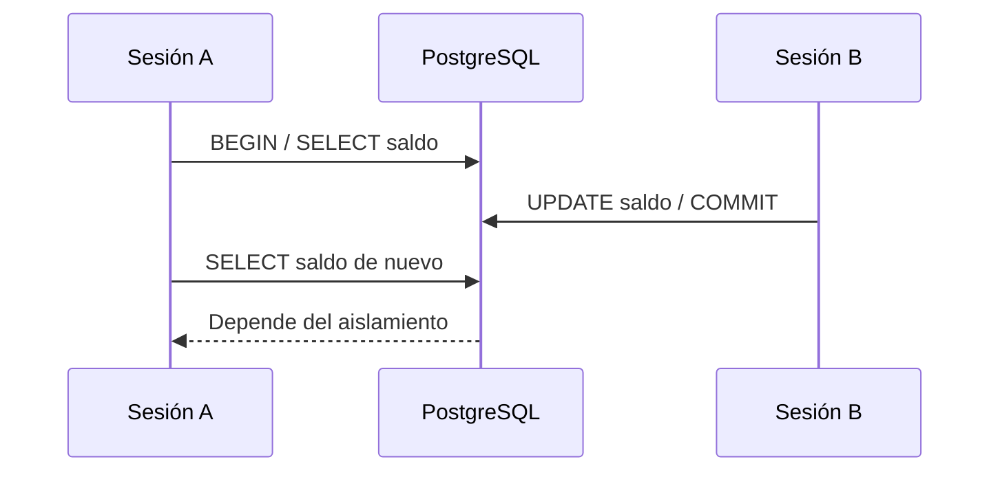

# Práctica 2.1. Análisis de concurrencia y niveles de aislamiento

**[⬅️ Anterior: Práctica 1.6](../../Capitulo01/Practica1-6/README.md)** | **[Lista general 🗂️](../README.md)** | **[Siguiente ➡️](../Practica2-2/README.md)**

## Objetivo de la práctica
- Identificar el efecto de MVCC sobre lecturas concurrentes.
- Reproducir una lectura no repetible en READ COMMITTED y una lectura estable en REPEATABLE READ.
- Detectar un bloqueo y observar su sesión responsable.

## Conceptos fundamentales
**MVCC** mantiene versiones de filas para que lectores y escritores puedan coexistir. **READ COMMITTED** crea una instantánea por sentencia; **REPEATABLE READ** mantiene una instantánea de la transacción. **SERIALIZABLE** puede abortar transacciones con `SQLSTATE 40001` para preservar un resultado equivalente a una ejecución serial. `SELECT ... FOR UPDATE` bloquea filas seleccionadas; la espera se observa con `pg_stat_activity` y `pg_blocking_pids()`. PostgreSQL no permite lecturas sucias incluso si se solicita READ UNCOMMITTED.

## Diagrama de arquitectura o procedimiento


## Duración aproximada
70 minutos.

## Requisitos y preparación
- Haber completado el laboratorio de instalación y disponer del servicio `debian-pg` saludable en Docker Compose.
- Ejecutar comandos desde la carpeta donde reside `compose.yaml`.
- Disponer de la base de datos `curso` y del usuario `postgres`.
- Abrir una o más terminales del anfitrión según se indique.
- **Seguridad:** todos los cambios se realizan en un entorno de laboratorio; no ejecutar sobre producción.

**Acceso a psql:**
```bash
docker compose exec --user postgres debian-pg psql -X -d curso
```

### Tarea 1. Preparar un caso bancario (sesión A)

Abrir **dos terminales del anfitrión**, desde `Capitulo02`, y conectar cada una con el comando SQL de la tabla de ayuda.

**Sesión A:**

```sql
CREATE SCHEMA IF NOT EXISTS lab_concurrencia;
DROP TABLE IF EXISTS lab_concurrencia.cuentas;
CREATE TABLE lab_concurrencia.cuentas (id integer PRIMARY KEY, titular text NOT NULL, saldo numeric(12,2) NOT NULL CHECK(saldo >= 0));
INSERT INTO lab_concurrencia.cuentas VALUES (1,'Ana',1000),(2,'Luis',800);
SELECT * FROM lab_concurrencia.cuentas ORDER BY id;
```
**Esperado:** dos cuentas, saldos 1000 y 800. Abrir dos conexiones independientes a `curso` (A y B).

### Tarea 2. READ COMMITTED: lectura no repetible
**Sesión A:**
```sql
BEGIN ISOLATION LEVEL READ COMMITTED;
SELECT saldo FROM lab_concurrencia.cuentas WHERE id=1; -- 1000
```
**Sesión B:**
```sql
UPDATE lab_concurrencia.cuentas SET saldo=1100 WHERE id=1; -- confirma automáticamente
```
**Sesión A:**
```sql
SELECT saldo FROM lab_concurrencia.cuentas WHERE id=1; -- 1100
COMMIT;
```
**Análisis:** una misma transacción A vio dos valores porque cada `SELECT` usa una instantánea nueva.

### Tarea 3. REPEATABLE READ: instantánea estable
**Sesión A:**
```sql
BEGIN ISOLATION LEVEL REPEATABLE READ;
SELECT saldo FROM lab_concurrencia.cuentas WHERE id=1; -- 1100; fija instantánea
```
**Sesión B:**
```sql
UPDATE lab_concurrencia.cuentas SET saldo=1200 WHERE id=1;
```
**Sesión A:**
```sql
SELECT saldo FROM lab_concurrencia.cuentas WHERE id=1; -- sigue 1100
COMMIT;
SELECT saldo FROM lab_concurrencia.cuentas WHERE id=1; -- 1200
```
**Esperado:** la transacción A mantiene 1100 hasta finalizar.

### Tarea 4. Bloqueos y monitoreo
**Sesión A:**
```sql
BEGIN;
SELECT pg_backend_pid() AS pid_a;
SELECT * FROM lab_concurrencia.cuentas WHERE id=2 FOR UPDATE; -- retiene bloqueo
```
**Sesión B:**
```sql
SET application_name='lab_2_1_B';
SET lock_timeout='8s'; -- evita espera indefinida
UPDATE lab_concurrencia.cuentas SET saldo=saldo+10 WHERE id=2; -- quedará esperando
```
**Mientras B espera, desde una tercera sesión C:**
```sql
SELECT pid,application_name,state,wait_event_type,wait_event,pg_blocking_pids(pid) AS bloqueadores
FROM pg_stat_activity WHERE application_name='lab_2_1_B';
```
**Esperado:** B espera un bloqueo (habitualmente tipo `Lock`), y `bloqueadores` incluye PID de A. Si vence `lock_timeout`, B recibe error; ejecutar `ROLLBACK` en B si está dentro de una transacción.

**Sesión A:** `COMMIT;` para liberar bloqueo. En B, `RESET lock_timeout;`.

### Tarea 5. SERIALIZABLE: decisión empresarial
Dos operadores leen que existe capacidad para un nuevo pedido y realizan escrituras dependientes. En `SERIALIZABLE` PostgreSQL puede abortar una de las transacciones con `40001` al detectar una dependencia peligrosa. **Regla de aplicación:** reintentar *toda* la transacción desde el inicio, nunca solo la sentencia fallida. La ocurrencia exacta del error depende del intercalado de operaciones.

## Resultado esperado
- READ COMMITTED: 1000 → 1100 en A.
- REPEATABLE READ: 1100 → 1100 dentro de A; 1200 tras COMMIT.
- Sesión B bloqueada mientras A conserva `FOR UPDATE`; el PID bloqueador es visible.

## Ejercicio de análisis
1. ¿Por qué READ UNCOMMITTED se comporta como READ COMMITTED en PostgreSQL?
2. ¿Cuándo conviene bloquear filas explícitamente?
3. ¿Por qué SERIALIZABLE exige lógica de reintentos?

## Evidencias de aprendizaje
- Captura o transcripción de las consultas y sus resultados.
- Explicación breve de qué cambió, por qué ocurrió y cómo comprobarlo.
- Respuestas a las preguntas de análisis y evidencia de la limpieza.

## Limpieza
```sql
DROP SCHEMA IF EXISTS lab_concurrencia CASCADE;
```
Cerrar sesiones con `\q` y comprobar que no quedaron transacciones abiertas.

## Bibliografía oficial y técnica
- [Transaction Isolation — PostgreSQL 18](https://www.postgresql.org/docs/18/transaction-iso.html)
- [Explicit Locking](https://www.postgresql.org/docs/18/explicit-locking.html)
- [Monitoring Database Activity](https://www.postgresql.org/docs/18/monitoring-activity.html)

**[⬅️ Anterior: Práctica 1.6](../../Capitulo01/Practica1-6/README.md)** | **[Lista general 🗂️](../README.md)** | **[Siguiente ➡️](../Practica2-2/README.md)**
