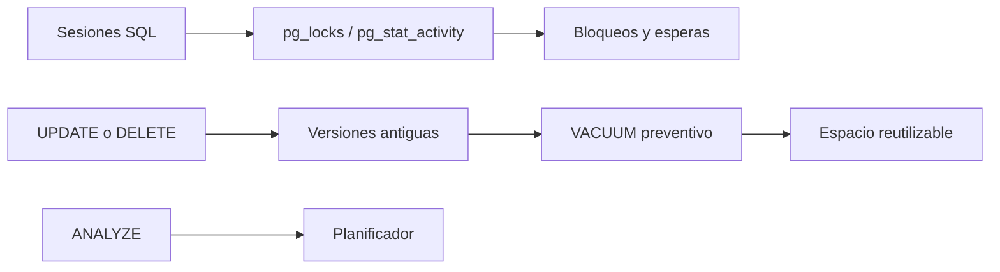

# Práctica 2.2. Monitoreo de Bloqueos y Mantenimiento Preventivo

**[⬅️ Anterior](../Practica2-1/README.md)** | **[Lista general 🗂️](../README.md)** | **[Siguiente ➡️](../Practica2-3/README.md)**

## Objetivo de la práctica
- Monitorear bloqueos con `pg_locks`, `pg_stat_activity` y `pg_blocking_pids()`.
- Distinguir VACUUM, ANALYZE y VACUUM FULL como mantenimiento preventivo.
- Medir versiones de filas obsoletas e identificar parámetros de autovacuum.

## Conceptos fundamentales
**Tupla muerta:** versión antigua que ya no es visible para transacciones activas. **VACUUM** permite reutilizar espacio dentro de la tabla y contribuye a prevenir problemas por envejecimiento de identificadores de transacción; no suele devolver espacio al sistema operativo. **ANALYZE** actualiza estadísticas del planificador. **VACUUM FULL** reescribe la tabla, requiere bloqueo exclusivo y espacio adicional. **Autovacuum** automatiza mantenimiento según umbrales. **pg_locks** expone los bloqueos activos por proceso, relación y modo; combinado con `pg_stat_activity` y `pg_blocking_pids()` permite identificar qué sesión retiene y cuáles esperan. El monitoreo preventivo evita que esperas prolongadas degraden el servicio antes de actuar.

## Diagrama de arquitectura o procedimiento


## Duración aproximada
65 minutos.

## Requisitos y preparación
- Haber completado el laboratorio de instalación y disponer del servicio `debian-pg` saludable en Docker Compose.
- Ejecutar comandos desde la carpeta donde reside `compose.yaml`.
- Disponer de la base de datos `curso` y del usuario `postgres`.
- Abrir una o más terminales del anfitrión según se indique.
- **Seguridad:** todos los cambios se realizan en un entorno de laboratorio; no ejecutar sobre producción.

**Acceso a psql:**
```bash
docker compose exec --user postgres debian-pg psql -X -d curso
```

### Tarea 1. Crear tabla de pedidos
```sql
CREATE SCHEMA IF NOT EXISTS lab_vacuum;
DROP TABLE IF EXISTS lab_vacuum.pedidos;
CREATE TABLE lab_vacuum.pedidos(id integer PRIMARY KEY, estado text, importe numeric);
INSERT INTO lab_vacuum.pedidos SELECT g,'pendiente',g*10 FROM generate_series(1,20000) g;
SELECT count(*) AS iniciales FROM lab_vacuum.pedidos; -- 20000
SELECT pg_size_pretty(pg_total_relation_size('lab_vacuum.pedidos')) AS tamano;
```
### Tarea 2. Provocar cambios
```sql
UPDATE lab_vacuum.pedidos SET estado='procesado' WHERE id<=8000;
DELETE FROM lab_vacuum.pedidos WHERE id BETWEEN 8001 AND 12000;
SELECT count(*) AS restantes FROM lab_vacuum.pedidos; -- 16000
SELECT n_live_tup,n_dead_tup,last_vacuum,last_autovacuum FROM pg_stat_user_tables
WHERE schemaname='lab_vacuum' AND relname='pedidos';
```
**Nota:** contadores aproximados y asincrónicos; autovacuum podría ejecutarse por su cuenta.

### Tarea 3. Mantener tabla
```sql
VACUUM (VERBOSE, ANALYZE) lab_vacuum.pedidos;
SELECT n_live_tup,n_dead_tup,last_vacuum,last_analyze FROM pg_stat_user_tables
WHERE schemaname='lab_vacuum' AND relname='pedidos';
SELECT count(*) FROM lab_vacuum.pedidos; -- 16000
```
**Esperado:** mantenimiento ejecutado, 16000 filas; `n_dead_tup` tenderá a disminuir. No ejecutar `VACUUM` dentro de `BEGIN ... COMMIT`.

### Tarea 4. Inspeccionar configuración
```sql
SHOW autovacuum;
SHOW autovacuum_vacuum_threshold;
SHOW autovacuum_vacuum_scale_factor;
SHOW autovacuum_analyze_scale_factor;
SELECT pid,backend_type,query FROM pg_stat_activity WHERE backend_type LIKE 'autovacuum%';
```
**Ejemplo:** con umbral 50 y factor 0.2, una tabla de 20000 filas alcanza el umbral nominal de VACUUM tras aproximadamente 4050 modificaciones pertinentes (sin considerar ajustes adicionales). No cambiar parámetros globales en esta práctica.

### Tarea 5. Monitorear bloqueos en tiempo real
**Paso 1.** Abrir una **segunda terminal** con psql (sesión B) y ejecutar:

```sql
BEGIN;
SELECT pg_backend_pid() AS pid_b;
UPDATE lab_vacuum.pedidos SET importe=importe+1 WHERE id=1;
-- NO cerrar la transacción todavía
```

**Paso 2.** En una **tercera terminal** (sesión C), intentar modificar la misma fila:

```sql
SET application_name='lab_2_2_C';
UPDATE lab_vacuum.pedidos SET importe=importe+2 WHERE id=1; -- quedará esperando
```

**Paso 3.** Desde una **cuarta terminal** (o desde B antes de confirmar), monitorear la espera:

```sql
SELECT blocked.pid AS pid_bloqueado,
       blocked.application_name,
       blocking.pid AS pid_bloqueador,
       blocked.wait_event_type,
       l.mode, l.locktype
FROM pg_locks l
JOIN pg_stat_activity blocked ON blocked.pid = l.pid
JOIN LATERAL unnest(pg_blocking_pids(blocked.pid)) AS bp(pid) ON true
JOIN pg_stat_activity blocking ON blocking.pid = bp.pid
WHERE NOT l.granted;
```

**Esperado:** la sesión C en espera con `wait_event_type=Lock`, el modo `RowExclusiveLock` sobre la tabla y el PID de B como bloqueador. Completar la tabla de evidencia:

| Rol | PID | Estado | Evento de espera |
| --- | --- | --- | --- |
| Sesión B (bloqueador) | |
| Sesión C (bloqueada) | |

**Paso 4.** En B, cerrar con `COMMIT;` (o `ROLLBACK;`). En C, verificar que el UPDATE se completó y ejecutar `RESET application_name;`. El monitoreo de bloqueos permite detectar y resolver esperas antes de que afecten al servicio.

## Resultado esperado
Tabla con 16000 filas; bloqueo monitoreado identificando bloqueador y bloqueado; registro de mantenimiento manual y explicación de la diferencia entre espacio reutilizable y espacio devuelto al sistema.

## Ejercicio de análisis
1. ¿Por qué `VACUUM FULL` no es una tarea rutinaria en horario productivo?
2. ¿Por qué `n_dead_tup` puede no coincidir exactamente con las filas modificadas?
3. ¿Qué efecto tendría desactivar autovacuum durante meses?
4. ¿Qué información aporta `pg_blocking_pids()` que no se ve en `pg_stat_activity`?

## Evidencias de aprendizaje
- Captura o transcripción de las consultas y sus resultados.
- Explicación breve de qué cambió, por qué ocurrió y cómo comprobarlo.
- Respuestas a las preguntas de análisis y evidencia de la limpieza.

## Limpieza
```sql
DROP SCHEMA IF EXISTS lab_vacuum CASCADE;
```

## Bibliografía oficial y técnica
- [Routine Vacuuming — PostgreSQL 18](https://www.postgresql.org/docs/18/routine-vacuuming.html)
- [VACUUM](https://www.postgresql.org/docs/18/sql-vacuum.html)
- [Monitoring Statistics](https://www.postgresql.org/docs/18/monitoring-stats.html)
- [pg_locks](https://www.postgresql.org/docs/18/view-pg-locks.html)

**[⬅️ Anterior](../Practica2-1/README.md)** | **[Lista general 🗂️](../README.md)** | **[Siguiente ➡️](../Practica2-3/README.md)**
