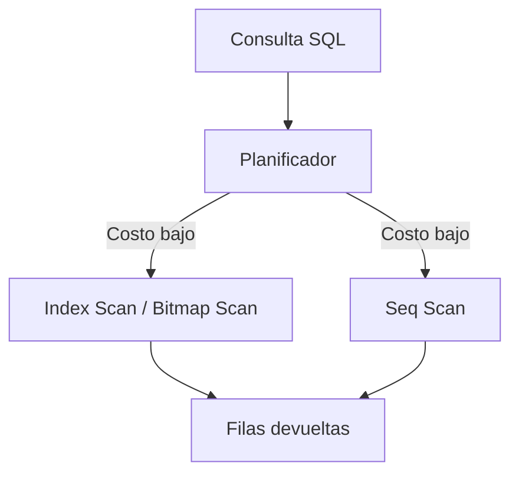

# Práctica 2.3. Administración de Índices y Optimización de Acceso a Datos

**[⬅️ Anterior](../Practica2-2/README.md)** | **[Lista general 🗂️](../README.md)** | **[Siguiente ➡️](../Practica2-4/README.md)**

## Objetivo de la práctica
- Crear índices adecuados para filtros y rangos.
- Comparar planes con EXPLAIN (ANALYZE, BUFFERS).
- Explicar costos de lectura, escritura y mantenimiento.

## Conceptos fundamentales
**B-tree** sirve para igualdad y rangos. **GIN** puede acelerar búsquedas sobre arreglos, documentos y `jsonb` según operadores y clases disponibles. **BRIN** resume bloques y puede ser eficiente en tablas grandes con correlación física. Un índice no garantiza que el optimizador lo utilice: decide por costo estimado, cardinalidad y estadísticas. `EXPLAIN ANALYZE` ejecuta realmente la consulta.

## Diagrama de arquitectura o procedimiento


## Duración aproximada
60 minutos.

## Requisitos y preparación
- Haber completado el laboratorio de instalación y disponer del servicio `debian-pg` saludable en Docker Compose.
- Ejecutar comandos desde la carpeta donde reside `compose.yaml`.
- Disponer de la base de datos `curso` y del usuario `postgres`.
- Abrir una o más terminales del anfitrión según se indique.
- **Seguridad:** todos los cambios se realizan en un entorno de laboratorio; no ejecutar sobre producción.

**Acceso a psql:**
```bash
docker compose exec --user postgres debian-pg psql -X -d curso
```

### Tarea 1. Generar ventas reproducibles
```sql
CREATE SCHEMA IF NOT EXISTS lab_indices;
DROP TABLE IF EXISTS lab_indices.ventas;
CREATE TABLE lab_indices.ventas(id bigint PRIMARY KEY, cliente_id integer NOT NULL, fecha date NOT NULL, total numeric(10,2));
INSERT INTO lab_indices.ventas
SELECT g, (g%10000)+1, DATE '2025-01-01'+(g%365), (g%5000)::numeric/10
FROM generate_series(1,200000) g;
ANALYZE lab_indices.ventas;
SELECT count(*) FROM lab_indices.ventas; -- 200000
```
### Tarea 2. Plan antes del índice
```sql
EXPLAIN (ANALYZE, BUFFERS)
SELECT * FROM lab_indices.ventas WHERE cliente_id=731;
```
Registrar tipo de escaneo, filas y tiempo. Puede variar según hardware y estadísticas.

### Tarea 3. Crear índice y comparar
```sql
CREATE INDEX idx_ventas_cliente ON lab_indices.ventas(cliente_id);
ANALYZE lab_indices.ventas;
EXPLAIN (ANALYZE, BUFFERS)
SELECT * FROM lab_indices.ventas WHERE cliente_id=731;
```
**Esperado:** habitualmente `Bitmap Index Scan` o `Index Scan` en filtro selectivo; no se garantiza un plan fijo.

### Tarea 4. Índice compuesto para consulta empresarial
```sql
CREATE INDEX idx_ventas_cliente_fecha ON lab_indices.ventas(cliente_id,fecha);
EXPLAIN (ANALYZE, BUFFERS)
SELECT * FROM lab_indices.ventas
WHERE cliente_id=731 AND fecha BETWEEN DATE '2025-03-01' AND DATE '2025-06-30';
SELECT indexname,indexdef FROM pg_indexes WHERE schemaname='lab_indices';
```
**Interpretación:** el orden de columnas importa. Comparar índices y justificar si ambos son necesarios.

### Tarea 5. Verificar costo de almacenamiento
```sql
SELECT indexrelname,pg_size_pretty(pg_relation_size(indexrelid)) AS tamano
FROM pg_stat_user_indexes WHERE schemaname='lab_indices' ORDER BY indexrelname;
```
No eliminar índices de producción basándose solo en una ejecución.

## Resultado esperado
200000 ventas, índices creados y comparación documentada de planes y buffers.

## Ejercicio de análisis
1. ¿Por qué el planificador puede elegir Seq Scan pese a existir índice?
2. ¿Qué diferencia existe entre índice `(cliente_id, fecha)` y `(fecha, cliente_id)`?
3. ¿Cómo afecta un índice adicional a INSERT y UPDATE?

## Evidencias de aprendizaje
- Captura o transcripción de las consultas y sus resultados.
- Explicación breve de qué cambió, por qué ocurrió y cómo comprobarlo.
- Respuestas a las preguntas de análisis y evidencia de la limpieza.

## Limpieza
```sql
DROP SCHEMA IF EXISTS lab_indices CASCADE;
```

## Bibliografía oficial y técnica
- [Indexes — PostgreSQL 18](https://www.postgresql.org/docs/18/indexes.html)
- [Using EXPLAIN](https://www.postgresql.org/docs/18/using-explain.html)
- [CREATE INDEX](https://www.postgresql.org/docs/18/sql-createindex.html)

**[⬅️ Anterior](../Practica2-2/README.md)** | **[Lista general 🗂️](../README.md)** | **[Siguiente ➡️](../Practica2-4/README.md)**
