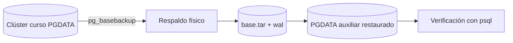

# Práctica 2.4. Implementación de Respaldos con pg_basebackup

**[⬅️ Anterior](../Practica2-3/README.md)** | **[Lista general 🗂️](../README.md)** | **[Siguiente ➡️](../Practica2-5/README.md)**

## Objetivo de la práctica

- Crear una copia física base del clúster con `pg_basebackup` en formato plano y tar.
- Verificar la integridad y el contenido del respaldo generado.
- Diferenciar el respaldo físico de la copia lógica y del PITR completo.

## Conceptos fundamentales

**pg_basebackup** copia físicamente los archivos del directorio de datos (PGDATA) del clúster en ejecución; es la base de cualquier estrategia de recuperación completa y del PITR. Con `--wal-method=stream` incluye el WAL necesario para garantizar consistencia. Con `-Ft` genera archivos tar comprimidos; con `-Fp` un directorio plano. Requiere conexión con privilegios de replicación (`pg_basebackup` usa el protocolo de replicación). Un respaldo físico aislado no permite recuperar una sola fila: restaura el clúster completo al momento de la copia (o a un punto temporal si se combina con archivado WAL). Nunca restaurar sobre un clúster en ejecución.

## Diagrama de arquitectura o procedimiento



## Duración aproximada

70 minutos.

## Requisitos y preparación

- Haber completado el laboratorio de instalación y disponer del servicio `debian-pg` saludable en Docker Compose.
- Ejecutar comandos desde la carpeta donde reside `compose.yaml`.
- Disponer de la base de datos `curso` y del usuario `postgres`.
- Espacio libre suficiente: la copia base duplica el tamaño de PGDATA en `/tmp` del contenedor.
- **Seguridad:** todos los cambios se realizan en un entorno de laboratorio; no ejecutar sobre producción.

**Acceso a psql:**

```bash
docker compose exec --user postgres debian-pg psql -X -d curso
```

### Tarea 1. Preparar datos de referencia

**En psql:**

```sql
CREATE SCHEMA IF NOT EXISTS lab_fisico;
DROP TABLE IF EXISTS lab_fisico.metricas;
CREATE TABLE lab_fisico.metricas(id integer PRIMARY KEY, valor numeric NOT NULL);
INSERT INTO lab_fisico.metricas VALUES (1,100),(2,200),(3,300);
SELECT count(*), sum(valor) FROM lab_fisico.metricas; -- 3, 600
```

Registrar la hora de la copia: `SELECT now();`.

### Tarea 2. Verificar prerrequisitos de replicación

**En psql:**

```sql
SHOW wal_level;         -- debe ser replica o logical
SHOW max_wal_senders;   -- debe ser > 0
SELECT rolname, rolreplication FROM pg_roles WHERE rolname = 'postgres';
```

**Desde el anfitrión, comprobar espacio disponible:**

```bash
docker compose exec debian-pg df -h /tmp
```

**Esperado:** `wal_level` distinto de `minimal`, senders disponibles y al menos 1 GB libre. `pg_basebackup` se conecta mediante replicación; el usuario `postgres` tiene el atributo necesario por defecto.

### Tarea 3. Crear la copia base física

**Desde el anfitrión**, generar el respaldo en formato tar con WAL incluido en streaming:

```bash
docker compose exec --user postgres debian-pg pg_basebackup -h 127.0.0.1 -p 5432 -U postgres -D /tmp/basebackup -Ft -z -X stream -P
```

| Opción | Significado |
| --- | --- |
| `-D /tmp/basebackup` | Directorio de destino de la copia |
| `-Ft -z` | Formato tar comprimido con gzip |
| `-X stream` | Incluir WAL por streaming (consistencia garantizada) |
| `-P` | Mostrar progreso |

Listar el contenido:

```bash
docker compose exec --user postgres debian-pg ls -lh /tmp/basebackup
```

**Esperado:** `base.tar.gz`, `pg_wal.tar.gz` y el manifiesto de respaldo. El tamaño debe aproximarse al de PGDATA: comprobar con `SELECT pg_size_pretty(pg_database_size('curso'));` en psql.

### Tarea 4. Verificar la integridad del respaldo

**Desde el anfitrión:**

```bash
docker compose exec --user postgres debian-pg ls -l /tmp/basebackup/base.tar.gz
docker compose exec --user postgres debian-pg tar -tzf /tmp/basebackup/base.tar.gz | head -20
docker compose exec --user postgres debian-pg tar -tzf /tmp/basebackup/base.tar.gz | grep -c 'PG_VERSION'
```

**Esperado:** el listado incluye `PG_VERSION`, `postgresql.conf`, `pg_hba.conf` y los directorios `base/` y `global/`; `grep -c` devuelve 1. La presencia de `PG_VERSION` y del manifiesto confirma una copia base completa.

### Tarea 5. Simular pérdida y verificar la copia (opcional, recomendado)

**En psql `curso`:** modificar datos después de la copia:

```sql
DELETE FROM lab_fisico.metricas WHERE id=2;
SELECT count(*), sum(valor) FROM lab_fisico.metricas; -- 2, 400
```

Descomprimir y arrancar el respaldo en un clúster auxiliar **en un puerto distinto** (nunca sobre el clúster activo):

```bash
docker compose exec debian-pg bash -c '
  install -d -m 700 -o postgres -g postgres /tmp/restore_test &&
  tar -xzf /tmp/basebackup/base.tar.gz -C /tmp/restore_test &&
  mkdir -p /tmp/restore_test/pg_wal &&
  tar -xzf /tmp/basebackup/pg_wal.tar.gz -C /tmp/restore_test/pg_wal &&
  chown -R postgres:postgres /tmp/restore_test'
docker compose exec -d --user postgres debian-pg \
  pg_ctl -D /tmp/restore_test -o "-p 5433 -c listen_addresses=''" -w start
docker compose exec --user postgres debian-pg psql -X -h 127.0.0.1 -p 5433 -d curso -c \
  'SELECT count(*), sum(valor) FROM lab_fisico.metricas;'
```

**Esperado:** 3 y 600 — el estado del momento de la copia, no el posterior al DELETE. El clúster auxiliar permite validar el respaldo sin tocar el principal.

### Resultado esperado

Copia base física creada con `pg_basebackup` (formato tar + WAL en streaming), integridad verificada por listado de tar y, si se ejecutó la Tarea 5, un clúster auxiliar que muestra los datos del momento de la copia (3 métricas, suma 600) mientras `curso` conserva sus cambios posteriores.

## Ejercicio de análisis

1. ¿Por qué `pg_basebackup` no depende de los tipos de datos ni de la estructura lógica, a diferencia de `pg_dump`?
2. ¿Qué papel cumple `pg_wal.tar.gz` para garantizar un respaldo consistente?
3. ¿Qué falta para convertir este respaldo en un PITR completo?

## Evidencias de aprendizaje

- Captura o transcripción de `pg_basebackup` con progreso y del listado del tar.
- Salida de `SHOW wal_level` y `max_wal_senders`.
- Comparación de tamaños entre PGDATA y la copia base.
- Respuestas a las preguntas de análisis y evidencia de la limpieza.

## Limpieza

**Desde el anfitrión:**

```bash
docker compose exec --user postgres debian-pg pg_ctl -D /tmp/restore_test -m fast -w stop
docker compose exec debian-pg bash -c 'rm -rf /tmp/basebackup /tmp/restore_test'
```

**En psql `curso`:**

```sql
DROP SCHEMA IF EXISTS lab_fisico CASCADE;
```

## Bibliografía oficial y técnica

- [Backup and Restore — PostgreSQL 18](https://www.postgresql.org/docs/18/backup.html)
- [pg_basebackup](https://www.postgresql.org/docs/18/app-pgbasebackup.html)
- [Continuous Archiving and PITR](https://www.postgresql.org/docs/18/continuous-archiving.html)
- [High Availability and Replication Overview](https://www.postgresql.org/docs/18/high-availability.html)

**[⬅️ Anterior](../Practica2-3/README.md)** | **[Lista general 🗂️](../README.md)** | **[Siguiente ➡️](../Practica2-5/README.md)**
