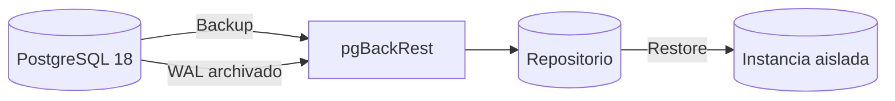

# Práctica 2.5. Configuración de pgBackRest

**[⬅️ Anterior](../Practica2-4/README.md)** | **[Lista general 🗂️](../README.md)** | **[Siguiente ➡️](../Practica2-6/README.md)**

## Objetivo de la práctica
- Reconocer los componentes de una stanza y un repositorio.
- Diseñar la configuración mínima de un respaldo empresarial.
- Practicar verificaciones de comandos sin alterar el clúster base.

## Conceptos fundamentales
**pgBackRest** es una herramienta externa a PostgreSQL para respaldos físicos, retención, restauración y gestión de WAL. Una **stanza** identifica un clúster PostgreSQL y sus parámetros de respaldo. Los respaldos incrementales y diferenciales dependen de una base válida. Su instalación requiere acceso al directorio de datos y configuración correcta de permisos, repositorio y archivado WAL. **Este laboratorio es de preparación y validación**, ya que el servicio `debian-pg` no garantiza que pgBackRest esté instalado.

## Diagrama de arquitectura o procedimiento


## Duración aproximada
60 minutos.

## Requisitos y preparación
- Haber completado el laboratorio de instalación y disponer del servicio `debian-pg` saludable en Docker Compose.
- Ejecutar comandos desde la carpeta donde reside `compose.yaml`.
- Disponer de la base de datos `curso` y del usuario `postgres`.
- Abrir una o más terminales del anfitrión según se indique.
- **Seguridad:** todos los cambios se realizan en un entorno de laboratorio; no ejecutar sobre producción.

**Acceso a psql:**
```bash
docker compose exec --user postgres debian-pg psql -X -d curso
```

### Tarea 1. Inspeccionar prerrequisitos
**En el anfitrión:**
```bash
docker compose exec debian-pg bash -lc 'command -v pgbackrest || echo "pgBackRest no instalado"'
docker compose exec --user postgres debian-pg psql -X -d curso -c 'SHOW data_directory;'
docker compose exec --user postgres debian-pg psql -X -d curso -c 'SHOW archive_mode;'
docker compose exec --user postgres debian-pg psql -X -d curso -c 'SHOW archive_command;'
```
**Esperado:** rutas y estado actual; `archive_mode=off` indica que aún falta preparar archivado WAL.

### Tarea 2. Diseñar configuración comentada (NO ejecutar sin adaptar)
Archivo de referencia `pgbackrest.conf` para un contenedor dedicado, con volúmenes persistentes y permisos adecuados:
```ini
[global]
repo1-path=/var/lib/pgbackrest
repo1-retention-full=2
log-level-console=info

[curso18]
pg1-path=/var/lib/postgresql/18/main
pg1-port=5432
```
**Nota:** la ruta real debe coincidir con `SHOW data_directory`; esta configuración por sí sola no habilita el archivado ni garantiza permisos.

### Tarea 3. Secuencia operativa, solo si la herramienta está instalada y configurada
```bash
# Validar que la stanza existe y el archivado funciona
pgbackrest --stanza=curso18 check
# Crear copia completa inicial
pgbackrest --stanza=curso18 --type=full backup
# Mostrar catálogo y estado
pgbackrest --stanza=curso18 info
```
**No ejecutar `restore` sobre una instancia activa.** Para la práctica operativa completa, Codex debe añadir al Compose un servicio o imagen con pgBackRest, repositorio persistente, acceso a PGDATA y configuración de `archive_command`, reinicio controlado y permisos, y probar restauración en instancia auxiliar.

### Tarea 4. Caso empresarial
Una cadena de sucursales exige conservar dos respaldos completos y WAL suficiente. Documentar dónde se guarda el repositorio, quién puede acceder, cómo se verifican las copias y qué se haría si el servidor original falla.

## Resultado esperado
Informe de prerrequisitos y diseño de stanza; si el entorno incorpora pgBackRest, salida de `check`, `backup` e `info`. **No se promete un respaldo exitoso sin instalación y configuración previa.**

## Ejercicio de análisis
1. ¿Por qué el repositorio no debe depender del mismo disco que la instancia?
2. ¿Qué diferencia hay entre respaldo completo, diferencial e incremental?
3. ¿Qué riesgos tiene restaurar sobre un servidor en ejecución?

## Evidencias de aprendizaje
- Captura o transcripción de las consultas y sus resultados.
- Explicación breve de qué cambió, por qué ocurrió y cómo comprobarlo.
- Respuestas a las preguntas de análisis y evidencia de la limpieza.

## Limpieza
No se modifica la instancia durante la inspección. Si se creó un entorno adicional, desmontarlo siguiendo su propio Compose, sin eliminar volúmenes con copias que deban conservarse.

## Bibliografía oficial y técnica
- [pgBackRest User Guide](https://pgbackrest.org/user-guide.html)
- [pgBackRest Configuration Reference](https://pgbackrest.org/configuration.html)
- [PostgreSQL 18: Continuous Archiving](https://www.postgresql.org/docs/18/continuous-archiving.html)

**[⬅️ Anterior](../Practica2-4/README.md)** | **[Lista general 🗂️](../README.md)** | **[Siguiente ➡️](../Practica2-6/README.md)**
