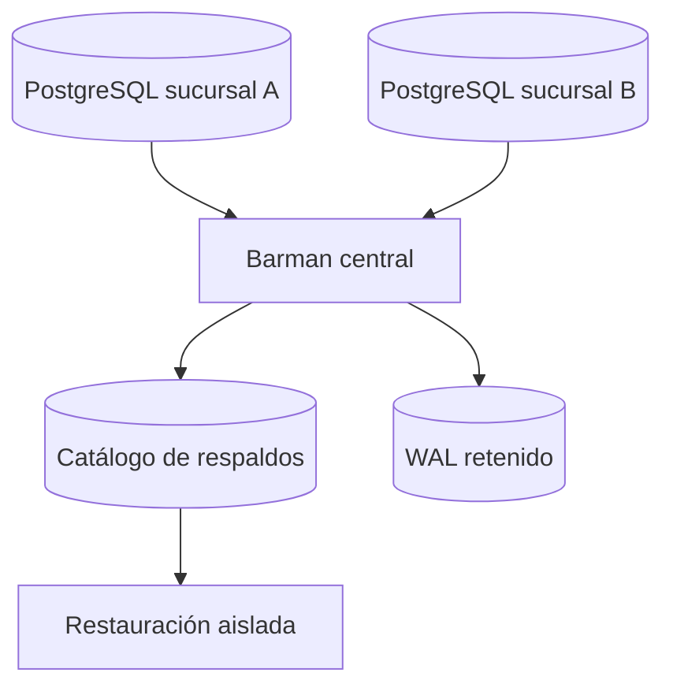

# Práctica 2.6. Administración de Respaldos con Barman

**[⬅️ Anterior](../Practica2-5/README.md)** | **[Lista general 🗂️](../README.md)** | **[Siguiente ➡️](../Practica2-7/README.md)**

## Objetivo de la práctica
- Explicar el papel del servidor central de respaldos.
- Preparar un inventario de instancias y parámetros.
- Ejecutar validaciones Barman cuando esté instalado.

## Conceptos fundamentales
**Barman** (Backup and Recovery Manager) centraliza respaldos físicos y WAL de uno o varios servidores PostgreSQL. Puede utilizar métodos de copia y recepción WAL según la arquitectura. Debe disponer de conectividad, credenciales, permisos y almacenamiento adecuados. Este laboratorio incluye una fase reproducible de diagnóstico y una fase operativa condicionada a disponer de Barman configurado.

## Diagrama de arquitectura o procedimiento


## Duración aproximada
55 minutos.

## Requisitos y preparación
- Haber completado el laboratorio de instalación y disponer del servicio `debian-pg` saludable en Docker Compose.
- Ejecutar comandos desde la carpeta donde reside `compose.yaml`.
- Disponer de la base de datos `curso` y del usuario `postgres`.
- Abrir una o más terminales del anfitrión según se indique.
- **Seguridad:** todos los cambios se realizan en un entorno de laboratorio; no ejecutar sobre producción.

**Acceso a psql:**
```bash
docker compose exec --user postgres debian-pg psql -X -d curso
```

### Tarea 1. Obtener inventario del servidor
**En anfitrión:**
```bash
docker compose exec --user postgres debian-pg psql -X -d curso -c 'SELECT version();'
docker compose exec --user postgres debian-pg psql -X -d curso -c 'SHOW wal_level;'
docker compose exec --user postgres debian-pg psql -X -d curso -c 'SHOW max_wal_senders;'
docker compose exec --user postgres debian-pg psql -X -d curso -c 'SHOW archive_mode;'
```
Anotar los valores y explicar cuáles afectan al transporte de WAL.

### Tarea 2. Diseño de una configuración de ejemplo
**Referencia didáctica, no lista para ejecutar sin credenciales y red:**
```ini
[curso18]
description = PostgreSQL 18 del laboratorio
conninfo = host=debian-pg user=barman dbname=postgres
backup_method = postgres
streaming_conninfo = host=debian-pg user=streaming_barman dbname=postgres
streaming_archiver = on
```
Los roles, permisos de replicación, `pg_hba.conf`, slots y resolución de red deben configurarse explícitamente en un entorno de Barman; no se incluyen contraseñas en el README.

### Tarea 3. Validaciones en un servidor Barman ya configurado
```bash
# Ejecutar en el servicio/host Barman, NO necesariamente en debian-pg
barman list-server
barman check curso18
barman backup curso18
barman list-backup curso18
barman show-backup curso18 latest
```
**Esperado:** si `check` informa errores, corregirlos antes de respaldar. Los comandos son operativos únicamente si existe un servidor Barman configurado.

### Tarea 4. Caso empresarial y política de recuperación
Diseñar una política para tres sucursales: ventana de backup, retención, alertas, ubicación del almacenamiento y prueba de restauración mensual. Registrar riesgos de pérdida de conexión y saturación del repositorio.

## Resultado esperado
Inventario del origen, esquema de centralización y resultados de `barman check` cuando exista entorno Barman operativo.

## Ejercicio de análisis
1. ¿Qué ventajas tiene centralizar respaldos de varias instancias?
2. ¿Qué sucede si Barman deja de recibir WAL?
3. ¿Cómo demostrar que un respaldo es recuperable?

## Evidencias de aprendizaje
- Captura o transcripción de las consultas y sus resultados.
- Explicación breve de qué cambió, por qué ocurrió y cómo comprobarlo.
- Respuestas a las preguntas de análisis y evidencia de la limpieza.

## Limpieza
No borrar repositorios. Si se creó un servicio Barman exclusivo del laboratorio, detenerlo y conservar evidencias y configuraciones para la práctica 2.7.

## Bibliografía oficial y técnica
- [Barman Documentation](https://docs.pgbarman.org/)
- [PostgreSQL 18: Backup and Restore](https://www.postgresql.org/docs/18/backup.html)
- [PostgreSQL 18: Streaming Replication Protocol](https://www.postgresql.org/docs/18/protocol-replication.html)

**[⬅️ Anterior](../Practica2-5/README.md)** | **[Lista general 🗂️](../README.md)** | **[Siguiente ➡️](../Practica2-7/README.md)**
