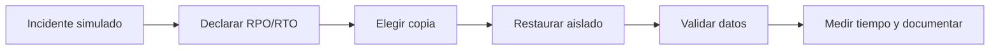

# Práctica 2.7. Simulación de recuperación ante desastres

**[⬅️ Anterior](../Practica2-6/README.md)** | **[Lista general 🗂️](../README.md)** | **[Siguiente ➡️](../../Capitulo03/Practica3-1.md)**

## Objetivo de la práctica
- Definir RPO y RTO en un escenario de interrupción.
- Ejecutar una restauración lógica aislada como simulacro introductorio.
- Diseñar un simulacro físico/PITR para una infraestructura preparada.

## Conceptos fundamentales
**RPO** es la pérdida máxima tolerable de datos medida en tiempo. **RTO** es el tiempo máximo objetivo para recuperar el servicio. Una prueba de recuperación no equivale a disponibilidad continua. El ejercicio reproducible usa `pg_dump`/`pg_restore` para practicar restauración aislada; un simulacro completo de PITR necesita respaldo físico y WAL archivado y debe ejecutarse con infraestructura específica.

## Diagrama de arquitectura o procedimiento


## Duración aproximada
65 minutos.

## Requisitos y preparación
- Haber completado el laboratorio de instalación y disponer del servicio `debian-pg` saludable en Docker Compose.
- Ejecutar comandos desde la carpeta donde reside `compose.yaml`.
- Disponer de la base de datos `curso` y del usuario `postgres`.
- Abrir una o más terminales del anfitrión según se indique.
- **Seguridad:** todos los cambios se realizan en un entorno de laboratorio; no ejecutar sobre producción.

**Acceso a psql:**
```bash
docker compose exec --user postgres debian-pg psql -X -d curso
```

### Tarea 1. Crear incidente ficticio
**En psql `curso`:**
```sql
CREATE SCHEMA IF NOT EXISTS lab_dr;
DROP TABLE IF EXISTS lab_dr.ordenes;
CREATE TABLE lab_dr.ordenes(id integer PRIMARY KEY, total numeric NOT NULL);
INSERT INTO lab_dr.ordenes VALUES (101,120.00),(102,80.00),(103,150.00);
SELECT count(*),sum(total) FROM lab_dr.ordenes; -- 3, 350
```
### Tarea 2. Respaldar antes del incidente
**Desde el anfitrión:**
```bash
docker compose exec --user postgres debian-pg pg_dump -Fc -d curso -n lab_dr -f /tmp/lab_dr.dump
```
Anotar hora de inicio/fin con el reloj del laboratorio.

### Tarea 3. Simular pérdida
**En psql `curso`:**
```sql
DELETE FROM lab_dr.ordenes WHERE id=102;
SELECT count(*),sum(total) FROM lab_dr.ordenes; -- 2, 270
```
### Tarea 4. Restaurar en entorno aislado
**Desde el anfitrión:**
```bash
docker compose exec --user postgres debian-pg createdb lab_dr_restore
docker compose exec --user postgres debian-pg pg_restore -d lab_dr_restore /tmp/lab_dr.dump
docker compose exec --user postgres debian-pg psql -X -d lab_dr_restore -c 'SELECT count(*),sum(total) FROM lab_dr.ordenes;'
```
**Esperado:** 3 órdenes y total 350. La base `curso` sigue con 2 órdenes: no hubo sobrescritura.

### Tarea 5. Reporte de simulacro
Registrar: incidente, fecha de backup, tiempo de detección, tiempo de restauración, filas recuperables, RPO observado y RTO observado. **Precisión:** esta práctica mide recuperación de datos en base aislada, no el restablecimiento completo de una aplicación. Para PITR físico, especificar clúster de destino, backup base, `restore_command` y `recovery_target_time` antes de ejecutarlo.

## Resultado esperado
Restauración aislada validada (3 órdenes; total 350) y reporte con RPO/RTO claramente delimitados.

## Ejercicio de análisis
1. ¿Por qué RTO no equivale solo a duración de `pg_restore`?
2. ¿Qué dependencia tiene PITR de la continuidad del archivo WAL?
3. ¿Qué pruebas funcionales exigiría un cliente empresarial antes de reabrir el servicio?

## Evidencias de aprendizaje
- Captura o transcripción de las consultas y sus resultados.
- Explicación breve de qué cambió, por qué ocurrió y cómo comprobarlo.
- Respuestas a las preguntas de análisis y evidencia de la limpieza.

## Limpieza
**Desde anfitrión:**
```bash
docker compose exec --user postgres debian-pg dropdb lab_dr_restore
docker compose exec --user postgres debian-pg rm -f /tmp/lab_dr.dump
```
**En psql `curso`:**
```sql
DROP SCHEMA IF EXISTS lab_dr CASCADE;
```

## Bibliografía oficial y técnica
- [PostgreSQL 18: Backup and Restore](https://www.postgresql.org/docs/18/backup.html)
- [PostgreSQL 18: Continuous Archiving and PITR](https://www.postgresql.org/docs/18/continuous-archiving.html)
- [PostgreSQL 18: pg_restore](https://www.postgresql.org/docs/18/app-pgrestore.html)

**[⬅️ Anterior](../Practica2-6/README.md)** | **[Lista general 🗂️](../README.md)** | **[Siguiente ➡️](../Practica2-8/README.md)**
