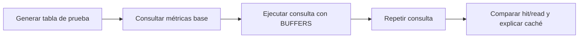

# Práctica 3.1. Monitoreo de Actividad y Rendimiento de Disco

**[⬅️ Anterior](../../Capitulo02/Practica2-7/README.md)** | **[Lista general 🗂️](../README.md)** | **[Siguiente ➡️](../Practica3-2/README.md)**

## Objetivo de la práctica
- Medir lecturas físicas y aciertos de caché de una tabla mediante estadísticas y `EXPLAIN (ANALYZE, BUFFERS)`.
- Interpretar contadores acumulados de I/O sin confundirlos con tiempos de una sola consulta.
- Relacionar el comportamiento de acceso a disco con decisiones de optimización.

## Conceptos fundamentales
**I/O (entrada/salida)** representa lecturas y escrituras de bloques. PostgreSQL utiliza **shared buffers** para almacenar páginas en memoria; `shared hit` indica una página encontrada en esa caché, y `shared read` indica una lectura solicitada fuera de ella (que puede ser satisfecha por caché del sistema operativo, no necesariamente por disco físico). `pg_stat_io` muestra contadores acumulados por tipo de backend, contexto y objeto; `pg_stat_database` agrega lecturas/aciertos por base de datos. `EXPLAIN (ANALYZE, BUFFERS)` mide la ejecución concreta y los buffers utilizados. No se deben inferir latencias físicas a partir de `shared read` solamente.

## Diagrama de arquitectura o procedimiento


## Duración aproximada
65 minutos.

## Requisitos y preparación
- PostgreSQL 18 y Docker Compose; servicio `debian-pg` en ejecución.
- Ejecutar los comandos de anfitrión desde la carpeta que contiene `compose.yaml`.
- Base de datos `curso` y acceso local como usuario del sistema `postgres`.
- **Seguridad:** laboratorio aislado; no ejecutar cargas, cambios de configuración ni limpiezas en producción.
- Los tiempos, planes y contadores dependen del hardware, caché y estadísticas: registrar resultados reales, no asumir valores fijos.

**Acceso a psql desde el anfitrión:**
```bash
# -X evita configuraciones personales de psql; -d selecciona la BD
 docker compose exec --user postgres debian-pg psql -X -d curso
```

### Tarea 1. Crear datos de prueba
**En psql `curso`:**
```sql
-- Aislar el ejercicio para no modificar tablas de otros capítulos
CREATE SCHEMA IF NOT EXISTS lab_io;
-- Eliminar solo la tabla de esta práctica si existe de una ejecución previa
DROP TABLE IF EXISTS lab_io.eventos;
-- Tabla con un identificador, categoría y texto de carga
CREATE TABLE lab_io.eventos (
  id bigint PRIMARY KEY,
  categoria integer NOT NULL,
  descripcion text NOT NULL
);
-- Generar 100.000 filas; repeat aumenta el tamaño de los datos
INSERT INTO lab_io.eventos(id, categoria, descripcion)
SELECT n, (n % 100), repeat('evento_', 15)
FROM generate_series(1, 100000) AS n;
-- Actualizar estadísticas del optimizador
ANALYZE lab_io.eventos;
```
### Tarea 2. Registrar contadores antes de consultar
**En psql `curso`:**
```sql
-- Los contadores son acumulados desde el último reinicio estadístico
SELECT datname, blks_read, blks_hit,
       round(100.0 * blks_hit / NULLIF(blks_hit + blks_read, 0), 2) AS hit_pct
FROM pg_stat_database WHERE datname = 'curso';
-- I/O por backend: lectura, escritura y aciertos de caché
SELECT backend_type, object, context, reads, writes, hits
FROM pg_stat_io
WHERE object = 'relation'
ORDER BY backend_type, context;
```
### Tarea 3. Ejecutar una consulta medible
**En psql `curso`:**
```sql
-- Primer plan: observar Seq Scan/Parallel Seq Scan y Buffers
EXPLAIN (ANALYZE, BUFFERS, SETTINGS)
SELECT count(*), sum(id)
FROM lab_io.eventos
WHERE descripcion LIKE 'evento_%';
-- Repetir la misma consulta: puede aumentar shared hit por caché
EXPLAIN (ANALYZE, BUFFERS, SETTINGS)
SELECT count(*), sum(id)
FROM lab_io.eventos
WHERE descripcion LIKE 'evento_%';
```
**Interpretación:** comparar `Buffers: shared hit` y `shared read`, `Execution Time` y tipo de recorrido. El plan puede cambiar; el sistema operativo también puede servir lecturas desde su propia caché.
### Tarea 4. Comprobar la tabla y registrar métricas finales
```sql
-- Tamaño físico aproximado de la relación completa
SELECT pg_size_pretty(pg_total_relation_size('lab_io.eventos')) AS tamano;
-- Volver a leer los contadores acumulados de la base de datos
SELECT datname, blks_read, blks_hit
FROM pg_stat_database WHERE datname = 'curso';
```
**Esperado:** 100.000 filas cargadas y dos planes ejecutados. Los valores de I/O y tiempo no son constantes; registrar los reales.

## Resultado esperado
El participante documenta dos ejecuciones comparables, identifica `shared hit`/`shared read`, reconoce la diferencia entre contadores globales y métricas de una consulta y explica la influencia de la caché.

## Ejercicio de análisis
1. ¿Por qué `shared read` no equivale necesariamente a lectura de disco físico?
2. ¿Qué diferencia existe entre `pg_stat_io` y `EXPLAIN (BUFFERS)`?
3. ¿Por qué una segunda ejecución puede ser más rápida sin modificar SQL?

## Evidencias de aprendizaje
- Transcripción o captura de las sentencias y resultados obtenidos.
- Comparación documentada de las métricas antes y después, con interpretación.
- Respuestas a las preguntas de análisis y evidencia de limpieza.

## Limpieza
**En psql `curso`:**
```sql
-- Eliminar exclusivamente los objetos de esta práctica
DROP SCHEMA IF EXISTS lab_io CASCADE;
```

## Bibliografía oficial y técnica
- [PostgreSQL 18 · Monitoring Database Activity](https://www.postgresql.org/docs/18/monitoring-stats.html)
- [PostgreSQL 18 · EXPLAIN](https://www.postgresql.org/docs/18/using-explain.html)
- [PostgreSQL 18 · ANALYZE](https://www.postgresql.org/docs/18/sql-analyze.html)
- [PostgreSQL 18 · Resource Consumption](https://www.postgresql.org/docs/18/runtime-config-resource.html)


**[⬅️ Anterior](../../Capitulo02/Practica2-7/README.md)** | **[Lista general 🗂️](../README.md)** | **[Siguiente ➡️](../Practica3-2/README.md)**
