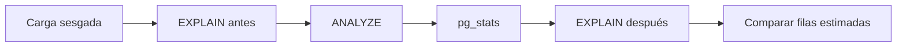

# Práctica 3.2. Análisis de Estadísticas con ANALYZE

**[⬅️ Anterior](../Practica3-1/README.md)** | **[Lista general 🗂️](../README.md)** | **[Siguiente ➡️](../Practica3-3/README.md)**

## Objetivo de la práctica
- Observar estimaciones de filas antes y después de recopilar estadísticas.
- Inspeccionar `pg_stats` y `pg_stat_user_tables` para comprender el recolector de estadísticas.
- Justificar cuándo ejecutar `ANALYZE` después de una carga de datos.

## Conceptos fundamentales
`ANALYZE` toma una muestra de los datos y actualiza las estadísticas que usa el **planificador** para estimar cardinalidad y selectividad. `pg_stats` expone, entre otros, `n_distinct`, `most_common_vals` e histogramas. `pg_stat_user_tables.last_analyze` indica el último análisis manual registrado. `ANALYZE` no reescribe los datos ni garantiza un cambio de plan. `EXPLAIN` sin `ANALYZE` muestra estimaciones; `EXPLAIN ANALYZE` ejecuta la consulta y permite contrastarlas.

## Diagrama de arquitectura o procedimiento


## Duración aproximada
60 minutos.

## Requisitos y preparación
- PostgreSQL 18 y Docker Compose; servicio `debian-pg` en ejecución.
- Ejecutar los comandos de anfitrión desde la carpeta que contiene `compose.yaml`.
- Base de datos `curso` y acceso local como usuario del sistema `postgres`.
- **Seguridad:** laboratorio aislado; no ejecutar cargas, cambios de configuración ni limpiezas en producción.
- Los tiempos, planes y contadores dependen del hardware, caché y estadísticas: registrar resultados reales, no asumir valores fijos.

**Acceso a psql desde el anfitrión:**
```bash
# -X evita configuraciones personales de psql; -d selecciona la BD
 docker compose exec --user postgres debian-pg psql -X -d curso
```

### Tarea 1. Crear una distribución de datos sesgada
**En psql `curso`:**
```sql
-- Esquema exclusivo del laboratorio
CREATE SCHEMA IF NOT EXISTS lab_stats;
DROP TABLE IF EXISTS lab_stats.pedidos;
CREATE TABLE lab_stats.pedidos (
  id bigint PRIMARY KEY,
  estado text NOT NULL,
  importe numeric(12,2) NOT NULL
);
-- 99% 'entregado' y 1% 'pendiente': distribución desigual
INSERT INTO lab_stats.pedidos(id, estado, importe)
SELECT n,
       CASE WHEN n <= 99000 THEN 'entregado' ELSE 'pendiente' END,
       (n % 500) + 10
FROM generate_series(1, 100000) AS n;
```
### Tarea 2. Comparar estimación inicial
```sql
-- Ejecuta la consulta y muestra filas estimadas vs reales
EXPLAIN (ANALYZE, BUFFERS)
SELECT * FROM lab_stats.pedidos WHERE estado = 'pendiente';
-- Estadísticas de mantenimiento (pueden estar vacías inicialmente)
SELECT relname, last_analyze, last_autoanalyze, n_live_tup
FROM pg_stat_user_tables
WHERE schemaname = 'lab_stats';
```
**Nota:** autovacuum/autoanalyze podría haber recopilado estadísticas antes de esta medición; documentar si ocurrió. No se garantiza una estimación incorrecta inicial.
### Tarea 3. Ejecutar ANALYZE y examinar estadísticas
```sql
-- Recopilar estadísticas con mensajes informativos
ANALYZE VERBOSE lab_stats.pedidos;
-- Ver distribución estimada de la columna estado
SELECT attname, null_frac, n_distinct,
       most_common_vals, most_common_freqs
FROM pg_stats
WHERE schemaname = 'lab_stats'
  AND tablename = 'pedidos'
  AND attname = 'estado';
```
### Tarea 4. Repetir y comparar
```sql
-- Comparar el número estimado de filas con el número real
EXPLAIN (ANALYZE, BUFFERS)
SELECT * FROM lab_stats.pedidos WHERE estado = 'pendiente';
-- Conteo real de referencia: 1.000 filas pendientes
SELECT count(*) AS pendientes
FROM lab_stats.pedidos WHERE estado = 'pendiente';
-- Fecha del último análisis manual
SELECT relname, last_analyze, last_autoanalyze
FROM pg_stat_user_tables WHERE schemaname = 'lab_stats';
```
**Esperado:** `pendientes = 1000`; `pg_stats` presenta información de distribución. El plan puede permanecer igual aunque las estimaciones mejoren.

## Resultado esperado
El estudiante verifica 1.000 pedidos pendientes, obtiene estadísticas de distribución y compara `rows` estimadas frente a filas reales antes/después de `ANALYZE`, aclarando la influencia de autoanalyze.

## Ejercicio de análisis
1. ¿Por qué una distribución sesgada afecta la selectividad?
2. ¿Qué diferencia existe entre `ANALYZE` y `EXPLAIN ANALYZE`?
3. ¿Por qué no siempre cambia el plan tras ejecutar `ANALYZE`?

## Evidencias de aprendizaje
- Transcripción o captura de las sentencias y resultados obtenidos.
- Comparación documentada de las métricas antes y después, con interpretación.
- Respuestas a las preguntas de análisis y evidencia de limpieza.

## Limpieza
**En psql `curso`:**
```sql
-- Borrar únicamente los objetos creados en esta práctica
DROP SCHEMA IF EXISTS lab_stats CASCADE;
```

## Bibliografía oficial y técnica
- [PostgreSQL 18 · Monitoring Database Activity](https://www.postgresql.org/docs/18/monitoring-stats.html)
- [PostgreSQL 18 · EXPLAIN](https://www.postgresql.org/docs/18/using-explain.html)
- [PostgreSQL 18 · ANALYZE](https://www.postgresql.org/docs/18/sql-analyze.html)
- [PostgreSQL 18 · Resource Consumption](https://www.postgresql.org/docs/18/runtime-config-resource.html)


**[⬅️ Anterior](../Practica3-1/README.md)** | **[Lista general 🗂️](../README.md)** | **[Siguiente ➡️](../Practica3-3/README.md)**
