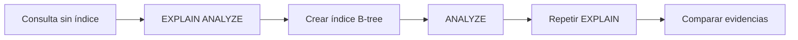

# Práctica 3.3. Comparación de Planes de Ejecución

**[⬅️ Anterior](../Practica3-2/README.md)** | **[Lista general 🗂️](../README.md)** | **[Siguiente ➡️](../Practica3-4/README.md)**

## Objetivo de la práctica
- Comparar métodos de acceso secuencial e indexado mediante `EXPLAIN (ANALYZE, BUFFERS)`.
- Medir costes estimados, tiempos reales, filas y buffers.
- Justificar una optimización basada en evidencias, sin asumir que siempre se utilizará un índice.

## Conceptos fundamentales
Un **plan de ejecución** describe cómo PostgreSQL obtiene y procesa los datos. `Seq Scan` recorre una tabla; `Index Scan` utiliza un índice para localizar filas; `Bitmap Heap Scan` combina localización por índice con lectura de páginas. `cost` es una estimación relativa, **no milisegundos**. `actual time` es el tiempo medido por nodo durante `EXPLAIN ANALYZE`. `BUFFERS` muestra uso de páginas; los resultados dependen del entorno.

## Diagrama de arquitectura o procedimiento


## Duración aproximada
70 minutos.

## Requisitos y preparación
- PostgreSQL 18 y Docker Compose; servicio `debian-pg` en ejecución.
- Ejecutar los comandos de anfitrión desde la carpeta que contiene `compose.yaml`.
- Base de datos `curso` y acceso local como usuario del sistema `postgres`.
- **Seguridad:** laboratorio aislado; no ejecutar cargas, cambios de configuración ni limpiezas en producción.
- Los tiempos, planes y contadores dependen del hardware, caché y estadísticas: registrar resultados reales, no asumir valores fijos.

**Acceso a psql desde el anfitrión:**
```bash
# -X evita configuraciones personales de psql; -d selecciona la BD
 docker compose exec --user postgres debian-pg psql -X -d curso
```

### Tarea 1. Preparar tabla de ventas
**En psql `curso`:**
```sql
-- Crear esquema aislado para comparar planes
CREATE SCHEMA IF NOT EXISTS lab_planes;
DROP TABLE IF EXISTS lab_planes.ventas;
CREATE TABLE lab_planes.ventas (
  id bigint PRIMARY KEY,
  id_cliente integer NOT NULL,
  fecha date NOT NULL,
  total numeric(12,2) NOT NULL
);
-- 200.000 ventas; cada cliente aparece unas 200 veces
INSERT INTO lab_planes.ventas(id, id_cliente, fecha, total)
SELECT n, ((n - 1) % 1000) + 1,
       DATE '2026-01-01' + ((n - 1) % 300),
       100 + (n % 1000)
FROM generate_series(1, 200000) AS n;
-- Obtener estadísticas iniciales
ANALYZE lab_planes.ventas;
```
### Tarea 2. Plan antes del índice
```sql
-- Medir tiempo y buffers de la consulta por cliente
EXPLAIN (ANALYZE, BUFFERS)
SELECT id, fecha, total
FROM lab_planes.ventas
WHERE id_cliente = 500;
-- Conteo real esperado: 200 ventas
SELECT count(*) FROM lab_planes.ventas WHERE id_cliente = 500;
```
**Esperado:** 200 filas; el plan normalmente será `Seq Scan` al no existir índice en `id_cliente`.
### Tarea 3. Crear índice y repetir
```sql
-- Índice B-tree para búsquedas por igualdad
CREATE INDEX idx_ventas_cliente
ON lab_planes.ventas (id_cliente);
-- Actualizar estadísticas tras la creación
ANALYZE lab_planes.ventas;
-- Comparar con el plan inicial
EXPLAIN (ANALYZE, BUFFERS)
SELECT id, fecha, total
FROM lab_planes.ventas
WHERE id_cliente = 500;
```
**Interpretación:** puede aparecer `Bitmap Heap Scan` o `Index Scan`. Registrar `Execution Time`, `rows` y `Buffers`; no afirmar una mejora si los datos no la muestran.
### Tarea 4. Contrastar un filtro poco selectivo
```sql
-- Esta consulta devuelve todas las filas: el índice puede no ayudar
EXPLAIN (ANALYZE, BUFFERS)
SELECT count(*) FROM lab_planes.ventas
WHERE id_cliente >= 1;
-- Revisar el índice y sus recorridos acumulados
SELECT indexrelname, idx_scan
FROM pg_stat_user_indexes
WHERE schemaname = 'lab_planes';
```
**Esperado:** un índice no garantiza ser elegido; el planificador considera selectividad y costes.

## Resultado esperado
El participante presenta dos planes medidos para una consulta selectiva, explica el método elegido, compara coste estimado, tiempo, filas y buffers y justifica si el índice aportó beneficio.

## Ejercicio de análisis
1. ¿Por qué `cost` no se interpreta como milisegundos?
2. ¿Cuándo puede preferirse `Seq Scan` incluso existiendo un índice?
3. ¿Qué indican `Rows Removed by Filter` y `Buffers: shared hit`?

## Evidencias de aprendizaje
- Transcripción o captura de las sentencias y resultados obtenidos.
- Comparación documentada de las métricas antes y después, con interpretación.
- Respuestas a las preguntas de análisis y evidencia de limpieza.

## Limpieza
**En psql `curso`:**
```sql
-- Elimina tabla e índice de este ejercicio
DROP SCHEMA IF EXISTS lab_planes CASCADE;
```

## Bibliografía oficial y técnica
- [PostgreSQL 18 · Monitoring Database Activity](https://www.postgresql.org/docs/18/monitoring-stats.html)
- [PostgreSQL 18 · EXPLAIN](https://www.postgresql.org/docs/18/using-explain.html)
- [PostgreSQL 18 · ANALYZE](https://www.postgresql.org/docs/18/sql-analyze.html)
- [PostgreSQL 18 · Resource Consumption](https://www.postgresql.org/docs/18/runtime-config-resource.html)


**[⬅️ Anterior](../Practica3-2/README.md)** | **[Lista general 🗂️](../README.md)** | **[Siguiente ➡️](../Practica3-4/README.md)**
