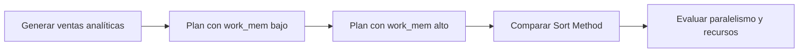

# Práctica 3.5. Optimización de Parámetros para Cargas OLAP

**[⬅️ Anterior](../Practica3-4/README.md)** | **[Lista general 🗂️](../README.md)** | **[Siguiente ➡️](../README.md)**

## Objetivo de la práctica
- Distinguir cargas OLAP basadas en lecturas y agregaciones masivas.
- Medir planes de agregación y ordenación con diferentes valores de `work_mem`.
- Identificar ordenaciones que utilizan disco y explicar límites del paralelismo.

## Conceptos fundamentales
**OLAP** (Online Analytical Processing) prioriza análisis de conjuntos grandes, agregaciones y ordenaciones. `work_mem` limita la memoria que puede usar **cada operación** de ordenación o hash antes de escribir datos temporales; no es un límite por consulta ni por servidor. `Sort Method: external merge Disk` señala una ordenación que utilizó archivos temporales. `max_parallel_workers_per_gather` limita trabajadores paralelos por nodo Gather, pero el planificador puede no emplearlos. Las pruebas utilizan `SET LOCAL` para no alterar la configuración global.

## Diagrama de arquitectura o procedimiento


## Duración aproximada
75 minutos.

## Requisitos y preparación
- PostgreSQL 18 y Docker Compose; servicio `debian-pg` en ejecución.
- Ejecutar los comandos de anfitrión desde la carpeta que contiene `compose.yaml`.
- Base de datos `curso` y acceso local como usuario del sistema `postgres`.
- **Seguridad:** laboratorio aislado; no ejecutar cargas, cambios de configuración ni limpiezas en producción.
- Los tiempos, planes y contadores dependen del hardware, caché y estadísticas: registrar resultados reales, no asumir valores fijos.

**Acceso a psql desde el anfitrión:**
```bash
# -X evita configuraciones personales de psql; -d selecciona la BD
 docker compose exec --user postgres debian-pg psql -X -d curso
```

### Tarea 1. Generar una tabla analítica
**En psql `curso`:**
```sql
-- Esquema aislado para cargas OLAP
CREATE SCHEMA IF NOT EXISTS lab_olap;
DROP TABLE IF EXISTS lab_olap.ventas;
CREATE TABLE lab_olap.ventas (
  id bigint PRIMARY KEY,
  region integer NOT NULL,
  cliente integer NOT NULL,
  monto numeric(12,2) NOT NULL
);
-- 300.000 filas: volumen moderado para un equipo de formación
INSERT INTO lab_olap.ventas(id, region, cliente, monto)
SELECT n, (n % 20), (n % 10000), 100 + (n % 300)
FROM generate_series(1, 300000) AS n;
ANALYZE lab_olap.ventas;
```
### Tarea 2. Medir ordenación con memoria reducida
```sql
-- Una transacción permite revertir automáticamente SET LOCAL
BEGIN;
-- Valor pequeño para favorecer el uso de archivos temporales
SET LOCAL work_mem = '64kB';
-- Ordenación por expresión no indexada; EXPLAIN ejecuta el plan
EXPLAIN (ANALYZE, BUFFERS, SETTINGS)
SELECT id, region, cliente, monto
FROM lab_olap.ventas
ORDER BY monto DESC, id DESC;
-- Finalizar sin cambios persistentes de parámetros
COMMIT;
```
**Observar:** `Sort Method`, `Disk`, `temp read` y `temp written` si aparecen. No hay una cifra fija; depende del plan y memoria.
### Tarea 3. Repetir con más memoria de trabajo
```sql
BEGIN;
-- Aumentar memoria solo en esta transacción de laboratorio
SET LOCAL work_mem = '64MB';
-- Misma consulta para comparar el método de ordenación
EXPLAIN (ANALYZE, BUFFERS, SETTINGS)
SELECT id, region, cliente, monto
FROM lab_olap.ventas
ORDER BY monto DESC, id DESC;
COMMIT;
```
**Interpretación:** si el plan muestra `Sort Method: quicksort Memory`, la ordenación ocurrió en memoria; si continúa usando disco, documentar el resultado real. Más memoria no siempre reduce el tiempo y puede elevar el consumo total con múltiples sesiones.
### Tarea 4. Explorar paralelismo en una agregación
```sql
BEGIN;
-- Permitir hasta dos trabajadores por nodo Gather (no garantiza uso)
SET LOCAL max_parallel_workers_per_gather = 2;
-- Permitir que el planificador considere planes paralelos en la sesión
SET LOCAL parallel_setup_cost = 0;
SET LOCAL parallel_tuple_cost = 0;
-- Agregar ventas por región
EXPLAIN (ANALYZE, BUFFERS, SETTINGS)
SELECT region, count(*) AS operaciones, sum(monto) AS total
FROM lab_olap.ventas
GROUP BY region
ORDER BY total DESC;
COMMIT;
```
**Esperado:** 20 regiones; puede aparecer `Gather`/`Partial Aggregate`, pero no es obligatorio. Comparar coste y tiempo sin asumir que el paralelismo siempre mejora el rendimiento.
### Tarea 5. Validación
```sql
-- Verificar las 300.000 filas cargadas
SELECT count(*) AS filas FROM lab_olap.ventas;
-- Confirmar que work_mem regresó al valor de la sesión
SHOW work_mem;
-- Consultar parámetro efectivo fuera de SET LOCAL
SHOW max_parallel_workers_per_gather;
```

## Resultado esperado
El estudiante compara planes de ordenación con `work_mem` bajo y alto, registra uso de archivos temporales y evalúa un plan de agregación paralela, justificando consumo de memoria y límites de concurrencia.

## Ejercicio de análisis
1. ¿Por qué `work_mem` no es una reserva fija por servidor?
2. ¿Qué significa `Sort Method: external merge Disk`?
3. ¿Por qué un plan paralelo puede resultar más lento que uno secuencial?

## Evidencias de aprendizaje
- Transcripción o captura de las sentencias y resultados obtenidos.
- Comparación documentada de las métricas antes y después, con interpretación.
- Respuestas a las preguntas de análisis y evidencia de limpieza.

## Limpieza
**En psql `curso`:**
```sql
-- Limpiar la tabla analítica y su esquema
DROP SCHEMA IF EXISTS lab_olap CASCADE;
```

## Bibliografía oficial y técnica
- [PostgreSQL 18 · Monitoring Database Activity](https://www.postgresql.org/docs/18/monitoring-stats.html)
- [PostgreSQL 18 · EXPLAIN](https://www.postgresql.org/docs/18/using-explain.html)
- [PostgreSQL 18 · ANALYZE](https://www.postgresql.org/docs/18/sql-analyze.html)
- [PostgreSQL 18 · Resource Consumption](https://www.postgresql.org/docs/18/runtime-config-resource.html)


**[⬅️ Anterior](../Practica3-4/README.md)** | **[Lista general 🗂️](../README.md)** | **[Siguiente ➡️](../README.md)**
