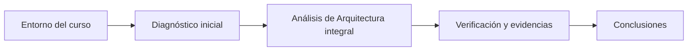

# Práctica 4.8. Arquitectura empresarial de alta disponibilidad

**[⬅️ Anterior](../Practica4-7/README.md)** | **[Lista general 🗂️](../README.md)** | **[Siguiente ➡️](../README.md)**

## Objetivo de la práctica
- Integrar replicación, Patroni, HAProxy, PgBouncer y respaldos en un simulacro.
- Reutilizar el entorno PostgreSQL 18 de los capítulos 1, 2 y 3.
- Registrar evidencias, limitaciones y conclusiones de una decisión operativa.

## Conceptos fundamentales
**Arquitectura integral:** esta práctica relaciona la continuidad del servicio con la arquitectura PostgreSQL, la gestión de datos comerciales y las mediciones de los capítulos anteriores. La alta disponibilidad no reemplaza los respaldos ni elimina la necesidad de probar la recuperación.

## Diagrama de arquitectura o procedimiento


## Duración aproximada
60 minutos, ampliables para implementar componentes de infraestructura en un entorno aislado.

## Requisitos y preparación
- Haber completado las prácticas correspondientes de los capítulos 1, 2 y 3.
- PostgreSQL 18, Debian 13 y Docker Compose, servicio `debian-pg`.
- Base existente `curso`; esquema comercial `empresa` cuando esté disponible.
- Ejecutar desde la carpeta del repositorio que contiene `compose.yaml`.
- No cambiar `postgresql.conf`, reiniciar servicios, promover réplicas ni borrar volúmenes del entorno compartido.

| Recurso | Valor de referencia |
|---|---|
| Servicio | `debian-pg` |
| Base de datos | `curso` |
| Esquema comercial | `empresa` |
| Versión | PostgreSQL 18 |
| Cliente | `psql` mediante Docker Compose |

## Instrucciones

### Tarea 1. Reconocer el entorno existente
**Paso 1.** Acceder a la base de datos del curso:
```bash
docker compose exec --user postgres debian-pg psql -X -d curso
```
**Paso 2.** Verificar versión y esquema:
```sql
SELECT current_database(), current_user, version();
SELECT schema_name FROM information_schema.schemata WHERE schema_name='empresa';
```
**Resultado esperado:** se identifica la base `curso`, la versión del motor y la presencia o ausencia del esquema comercial.

### Tarea 2. Examinar arquitectura integral
**Paso 1.** Ejecutar la consulta de diagnóstico:
```sql
SELECT current_database(), pg_is_in_recovery(), now();
```
**Paso 2.** Complementar con:
```sql
SELECT count(*) AS sesiones FROM pg_stat_activity WHERE datname='curso';
```
**Paso 3.** Registrar los valores reales y explicar su significado. Una vista sin filas no implica necesariamente un error; puede indicar que el componente aún no está configurado.

### Tarea 3. Aplicación empresarial y análisis
**Paso 1.** Revisar las tablas disponibles de `empresa` sin alterar los datos:
```sql
SELECT table_name FROM information_schema.tables
WHERE table_schema='empresa' AND table_type='BASE TABLE'
ORDER BY table_name;
```
**Paso 2.** Establecer RPO y RTO, simular conceptualmente un failover y planificar una prueba PITR aislada.

**Paso 3.** Documentar cómo el escenario afecta clientes, productos, ventas o su disponibilidad, según las tablas efectivamente presentes en el repositorio.

## Resultados esperados
- Acceso validado al entorno de los capítulos anteriores.
- Diagnóstico reproducible y capturas o transcripciones de consultas.
- Explicación del componente y sus dependencias.
- Propuesta de verificación sin afectar los datos comerciales.
- Identificación de los pasos que requieren un clúster de laboratorio adicional.

## Evidencias
1. Salida de las consultas de las tareas 1 y 2.
2. Inventario de tablas del esquema `empresa` (si existe).
3. Breve conclusión sobre disponibilidad, integridad y recuperación.

## Preguntas de análisis
- ¿Qué riesgo empresarial cubre el componente?
- ¿Qué información del diagnóstico demuestra su estado?
- ¿Qué pasos serían necesarios para probarlo en una infraestructura aislada?

## Errores frecuentes y soluciones
- **Servicio no encontrado:** ejecutar desde el directorio del `compose.yaml` correcto y comprobar `docker compose ps`.
- **Base `curso` no disponible:** revisar el Capítulo 1 antes de continuar.
- **Vistas sin datos:** distinguir ausencia de actividad de fallo de consulta.
- **Permisos insuficientes:** verificar el usuario utilizado sin elevar privilegios innecesariamente.

## Limpieza
No se crean ni eliminan objetos. Salir de `psql` con `\q`. Conservar el servicio y los volúmenes del curso.

## Referencias
- [PostgreSQL 18 — Documentación oficial](https://www.postgresql.org/docs/18/)
- [Capítulo 1](../../Capitulo01/README.md) · [Capítulo 2](../../Capitulo02/README.md) · [Capítulo 3](../../Capitulo03/README.md)

> **Alcance:** Estas consultas son ejecutables sobre el entorno existente; la puesta en marcha de componentes adicionales (standby, Patroni, HAProxy o PgBouncer) requiere infraestructura separada y no se presume instalada.
