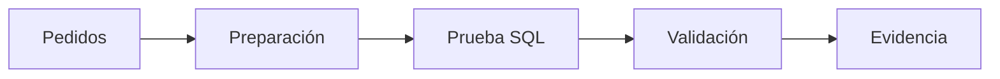

# Práctica 5.3. Implementación de Triggers y Auditoría Automática

**Netec · PostgreSQL Avanzado · El Salvador**

[⬅️ Anterior](../Practica5-2/README.md) · [Índice](../README.md) · [Siguiente ➡️](../Practica5-4/README.md)

## Objetivo
Aplicar implementación de triggers y auditoría automática al ciclo de pedidos de la empresa, conservando los datos del capítulo 4.

## Flujo de trabajo


## Preparación común
Desde Windows, entrar al contenedor existente (sin modificar Compose, Dockerfile ni entrypoint):
```bash
docker exec -it -u root postgres-ca-debian13-lab bash
# Confirmar el clúster principal y la base existente.
pg_lsclusters
runuser -u postgres -- psql -X -p 5432 -d lab_storage -v ON_ERROR_STOP=1
```
Dentro de psql:
```sql
SELECT current_database(), current_setting('server_version'), pg_is_in_recovery();
-- Debe ser lab_storage, PostgreSQL 18 y false.
SELECT to_regclass('lab_c4_integrador.pedidos');
```
Si no existe la tabla anterior, detenerse y revisar el capítulo 4. No trabajar sobre una réplica ni sobre Patroni. Ejecutar los bloques en orden, en psql con autocommit, salvo donde se indique BEGIN. Los resultados son esperados, no mediciones realizadas. Se usa un esquema nuevo `lab_c5_integrador` para conservar los pedidos originales. No limpiar entre prácticas.

## Tarea 1. Reglas de negocio y auditoría
```sql
CREATE TABLE lab_c5_integrador.auditoria (
 id bigint GENERATED ALWAYS AS IDENTITY PRIMARY KEY,
 operacion text NOT NULL, usuario text NOT NULL, fecha timestamptz NOT NULL DEFAULT clock_timestamp(),
 anterior jsonb, nuevo jsonb
);
CREATE FUNCTION lab_c5_integrador.validar_pedido() RETURNS trigger LANGUAGE plpgsql AS $$
BEGIN
 IF NEW.total<=0 THEN
  RAISE EXCEPTION 'El total debe ser positivo' USING ERRCODE='23514', HINT='Revise el importe';
 END IF;
 IF NEW.estado NOT IN ('PENDIENTE','CONFIRMADO','ANULADO') THEN
  RAISE EXCEPTION 'Estado inválido' USING ERRCODE='23514';
 END IF;
 RETURN NEW;
END; $$;
CREATE TRIGGER c5_validar BEFORE INSERT OR UPDATE ON lab_c5_integrador.pedidos
FOR EACH ROW EXECUTE FUNCTION lab_c5_integrador.validar_pedido();
CREATE FUNCTION lab_c5_integrador.auditar_pedido() RETURNS trigger LANGUAGE plpgsql AS $$
BEGIN
 INSERT INTO lab_c5_integrador.auditoria(operacion,usuario,anterior,nuevo)
 VALUES(TG_OP,session_user,CASE WHEN TG_OP<>'INSERT' THEN to_jsonb(OLD) END,
 CASE WHEN TG_OP<>'DELETE' THEN to_jsonb(NEW) END);
 RETURN NULL; -- AFTER ignora el valor retornado.
END; $$;
CREATE TRIGGER c5_auditar AFTER INSERT OR UPDATE OR DELETE ON lab_c5_integrador.pedidos
FOR EACH ROW EXECUTE FUNCTION lab_c5_integrador.auditar_pedido();
INSERT INTO lab_c5_integrador.pedidos VALUES(-503,'Cliente C',300,'PENDIENTE', '2026-01-01');
UPDATE lab_c5_integrador.pedidos SET total=350 WHERE id_pedido=-503;
DELETE FROM lab_c5_integrador.pedidos WHERE id_pedido=-503;
SELECT operacion,anterior,nuevo FROM lab_c5_integrador.auditoria ORDER BY id;
DO $$ BEGIN
 BEGIN
  UPDATE lab_c5_integrador.pedidos SET total=-1 WHERE id_pedido=-502;
 EXCEPTION WHEN check_violation THEN RAISE NOTICE 'Regla aplicada: %',SQLERRM;
 END;
END; $$;
```
Esperado: tres registros de auditoría y rechazo del total negativo. La auditoría es transaccional: un ROLLBACK revierte también el registro. Para auditoría de intentos fallidos usar mecanismos externos o logs apropiados. No conceder acceso de escritura directo a la tabla de auditoría a usuarios finales; este ejemplo usa postgres únicamente para enseñanza.
## Tarea 2. Trigger por sentencia
```sql
CREATE FUNCTION lab_c5_integrador.notificar_lote() RETURNS trigger LANGUAGE plpgsql AS $$
BEGIN
 RAISE NOTICE 'Sentencia UPDATE: % filas', (SELECT count(*) FROM filas_nuevas);
 RETURN NULL;
END; $$;
CREATE TRIGGER c5_lote AFTER UPDATE ON lab_c5_integrador.pedidos
REFERENCING NEW TABLE AS filas_nuevas FOR EACH STATEMENT
EXECUTE FUNCTION lab_c5_integrador.notificar_lote();
UPDATE lab_c5_integrador.pedidos SET total=total WHERE id_pedido IN (-501,-502);
```
Esperado: un NOTICE con 2 filas y dos registros de auditoría. INSTEAD OF se utiliza en vistas, no en tablas ordinarias. Para reglas simples preferir CHECK, UNIQUE y claves foráneas.
## Reto
Agregar una regla de transición de estados y probar INSERT, UPDATE, DELETE y ROLLBACK. Explicar la diferencia entre session_user y current_user.

## Evidencias y diagnóstico
Guardar las consultas, resultados reales y explicación de errores. Si aparece 42P01, comprobar que se ejecutaron las prácticas anteriores; si aparece 42501, revisar permisos; si aparece 25P02, ejecutar ROLLBACK antes de continuar. No borrar objetos de otros capítulos. La limpieza se realiza únicamente al final del capítulo.

[Índice](../README.md) · [Continuar](../Practica5-4/README.md)
