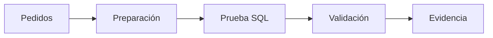

# Práctica 5.4. Control de cambios mediante Event Triggers

**Netec · PostgreSQL Avanzado · El Salvador**

[⬅️ Anterior](../Practica5-3/README.md) · [Índice](../README.md) · [Siguiente ➡️](../Practica5-5/README.md)

## Objetivo
Aplicar control de cambios mediante event triggers al ciclo de pedidos de la empresa, conservando los datos del capítulo 4.

## Flujo de trabajo


## Preparación común
Desde Windows, entrar al contenedor existente (sin modificar Compose, Dockerfile ni entrypoint):
```bash
docker exec -it -u root postgres-ca-debian13-lab bash
# Confirmar el clúster principal y la base existente.
pg_lsclusters
runuser -u postgres -- psql -X -p 5432 -d lab_storage -v ON_ERROR_STOP=1
```
Dentro de psql:
```sql
SELECT current_database(), current_setting('server_version'), pg_is_in_recovery();
-- Debe ser lab_storage, PostgreSQL 18 y false.
SELECT to_regclass('lab_c4_integrador.pedidos');
```
Si no existe la tabla anterior, detenerse y revisar el capítulo 4. No trabajar sobre una réplica ni sobre Patroni. Ejecutar los bloques en orden, en psql con autocommit, salvo donde se indique BEGIN. Los resultados son esperados, no mediciones realizadas. Se usa un esquema nuevo `lab_c5_integrador` para conservar los pedidos originales. No limpiar entre prácticas.

## Tarea 1. Auditar DDL del esquema del laboratorio
Requiere superusuario. Los event triggers son de ámbito de base de datos, por lo que se filtran los objetos del esquema de práctica. No se incluyen TRUNCATE (trigger DML por sentencia), ni objetos compartidos como roles o bases. No bloquear DDL globalmente.
```sql
CREATE TABLE lab_c5_integrador.auditoria_ddl (
 id bigint GENERATED ALWAYS AS IDENTITY PRIMARY KEY,
 fecha timestamptz DEFAULT clock_timestamp(), usuario text,
 evento text, objeto text
);
CREATE FUNCTION lab_c5_integrador.auditar_ddl() RETURNS event_trigger LANGUAGE plpgsql AS $$
BEGIN
 INSERT INTO lab_c5_integrador.auditoria_ddl(usuario,evento,objeto)
 SELECT session_user,TG_TAG,object_identity FROM pg_event_trigger_ddl_commands()
 WHERE schema_name='lab_c5_integrador';
END; $$;
CREATE FUNCTION lab_c5_integrador.auditar_drop() RETURNS event_trigger LANGUAGE plpgsql AS $$
BEGIN
 INSERT INTO lab_c5_integrador.auditoria_ddl(usuario,evento,objeto)
 SELECT session_user,TG_TAG,object_identity FROM pg_event_trigger_dropped_objects()
 WHERE schema_name='lab_c5_integrador' AND original;
END; $$;
CREATE EVENT TRIGGER netec_c5_ddl ON ddl_command_end EXECUTE FUNCTION lab_c5_integrador.auditar_ddl();
CREATE EVENT TRIGGER netec_c5_drop ON sql_drop EXECUTE FUNCTION lab_c5_integrador.auditar_drop();
CREATE TABLE lab_c5_integrador.ddl_demo(id integer);
ALTER TABLE lab_c5_integrador.ddl_demo ADD COLUMN descripcion text;
DROP TABLE lab_c5_integrador.ddl_demo;
SELECT evento,objeto FROM lab_c5_integrador.auditoria_ddl ORDER BY id;
SELECT evtname,evtevent,evtenabled FROM pg_event_trigger WHERE evtname IN ('netec_c5_ddl','netec_c5_drop');
-- Desactivar al terminar para evitar impacto sobre las prácticas posteriores.
ALTER EVENT TRIGGER netec_c5_ddl DISABLE;
ALTER EVENT TRIGGER netec_c5_drop DISABLE;
```
Esperado: registros CREATE TABLE, ALTER TABLE y DROP TABLE; puede haber más de un objeto por comando. `ddl_command_start` ocurre antes del comando, `ddl_command_end` después, `sql_drop` identifica objetos eliminados y `table_rewrite` detecta determinadas reescrituras. El registro también se revierte si la transacción falla.
## Reto
Diseñar una política de cambios con una ventana de mantenimiento y evaluar falsos positivos. Probar que crear una tabla en otro esquema no genera auditoría del laboratorio, utilizando un esquema de prueba autorizado y eliminándolo después. No activar políticas de bloqueo global.

## Evidencias y diagnóstico
Guardar las consultas, resultados reales y explicación de errores. Si aparece 42P01, comprobar que se ejecutaron las prácticas anteriores; si aparece 42501, revisar permisos; si aparece 25P02, ejecutar ROLLBACK antes de continuar. No borrar objetos de otros capítulos. La limpieza se realiza únicamente al final del capítulo.

[Índice](../README.md) · [Continuar](../Practica5-5/README.md)
