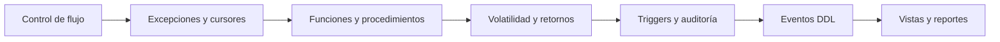

# Capítulo 5 · Programación en PL/pgSQL y Automatización

**Netec · PostgreSQL Avanzado · El Salvador · PostgreSQL 18 · Debian 13**

[⬅️ Capítulo 4](../Capitulo04/README.md) · [Repositorio general](../README.md) · [Comenzar práctica 5.1](Practica5-1/README.md)

## Continuidad
Se conserva el clúster principal y la base `lab_storage`, con el modelo de pedidos `lab_c4_integrador.pedidos`. El nuevo esquema aísla las prácticas. No se modifica infraestructura ni el capítulo anterior. Para navegación bidireccional, añadir al final del README existente de Capitulo04: `[Capítulo 5 ➡️](../Capitulo05/README.md)`.

## Objetivo general
Construir lógica de servidor, validar reglas empresariales y generar reportes reproducibles. Duración de referencia del capítulo: 8 horas; ajustar el tiempo práctico según el grupo.

## Preparación común
Desde Windows, entrar al contenedor existente (sin modificar Compose, Dockerfile ni entrypoint):
```bash
docker exec -it -u root postgres-ca-debian13-lab bash
# Confirmar el clúster principal y la base existente.
pg_lsclusters
runuser -u postgres -- psql -X -p 5432 -d lab_storage -v ON_ERROR_STOP=1
```
Dentro de psql:
```sql
SELECT current_database(), current_setting('server_version'), pg_is_in_recovery();
-- Debe ser lab_storage, PostgreSQL 18 y false.
SELECT to_regclass('lab_c4_integrador.pedidos');
```
Si no existe la tabla anterior, detenerse y revisar el capítulo 4. No trabajar sobre una réplica ni sobre Patroni. Ejecutar los bloques en orden, en psql con autocommit, salvo donde se indique BEGIN. Los resultados son esperados, no mediciones realizadas. Se usa un esquema nuevo `lab_c5_integrador` para conservar los pedidos originales. No limpiar entre prácticas.

## Laboratorios

| Práctica | Tema | Acceso |
|---|---|---|
| 5.1 | Desarrollo de Functions y Procedures en PL/pgSQL | [README](Practica5-1/README.md) |
| 5.2 | Manejo de Excepciones, Cursores y Procesamiento de Datos | [README](Practica5-2/README.md) |
| 5.3 | Implementación de Triggers y Auditoría Automática | [README](Practica5-3/README.md) |
| 5.4 | Control de cambios mediante Event Triggers | [README](Practica5-4/README.md) |
| 5.5 | Implementación de Vistas y Vistas Materializadas para Reportes | [README](Practica5-5/README.md) |

## Material visual
Infografías institucionales existentes como apoyo conceptual, no como scripts ejecutables. Los bloques SQL de las prácticas son la referencia operativa.

- [Tema 5.7](../images/capitulo05/Tema_5.7.png)
- [Tema 5.8](../images/capitulo05/Tema_5.8.png)
- [Tema 5.9](../images/capitulo05/Tema_5.9.png)
- [Tema 5.10](../images/capitulo05/Tema_5.10.png)
- [Tema 5.11](../images/capitulo05/Tema_5.11.png)

## Mapa de aprendizaje

## 5.1 Uso avanzado de bucles y estructuras condicionales

**Objetivo específico:** Controlar el flujo de una rutina PL/pgSQL según condiciones y conjuntos de datos.

### Conceptos fundamentales ampliados

**IF / ELSIF / ELSE.** Evalúa condiciones booleanas y ejecuta ramas mutuamente excluyentes.

**CASE.** Permite seleccionar una expresión o instrucción según varios casos.

**LOOP / WHILE / FOR.** Repiten instrucciones; LOOP necesita una salida explícita, WHILE evalúa condición y FOR recorre rangos o consultas.

**EXIT / CONTINUE.** Terminan o saltan una iteración, opcionalmente con WHEN.

**Consideraciones de diseño.** Evaluar siempre el alcance de las transacciones, el volumen de filas, los permisos necesarios y la facilidad de prueba. Preferir restricciones declarativas y operaciones sobre conjuntos cuando resuelvan el problema con menor complejidad. Separar el código reutilizable de la lógica de presentación.

### Glosario de palabras clave

| Término | Definición |
|---|---|
| **IF / ELSIF / ELSE** | Evalúa condiciones booleanas y ejecuta ramas mutuamente excluyentes. |
| **CASE** | Permite seleccionar una expresión o instrucción según varios casos. |
| **LOOP / WHILE / FOR** | Repiten instrucciones; LOOP necesita una salida explícita, WHILE evalúa condición y FOR recorre rangos o consultas. |
| **EXIT / CONTINUE** | Terminan o saltan una iteración, opcionalmente con WHEN. |
| **Bloque** | Unidad DECLARE/BEGIN/END con variables y ámbito propio. |
| **Iteración** | Ejecución individual de un ciclo. |

### Preguntas de comprobación
1. ¿Qué problema resuelve este mecanismo y cuándo no conviene utilizarlo?
2. ¿Qué impacto tiene sobre transacciones, permisos y rendimiento?
3. ¿Cómo comprobarías su comportamiento con una prueba reproducible?

## 5.2 Manejo de excepciones dinámicas y personalización de errores

**Objetivo específico:** Gestionar fallos de forma controlada y comunicar errores de negocio.

### Conceptos fundamentales ampliados

**EXCEPTION.** Captura condiciones de error dentro de un bloque PL/pgSQL; las modificaciones persistentes del bloque se revierten al entrar al manejador.

**SQLSTATE.** Código de cinco caracteres que identifica una condición de error.

**RAISE.** Emite mensajes DEBUG, NOTICE, WARNING o EXCEPTION; admite USING ERRCODE, DETAIL y HINT.

**GET STACKED DIAGNOSTICS.** Recupera datos del error capturado, como MESSAGE_TEXT y RETURNED_SQLSTATE.

**Consideraciones de diseño.** Evaluar siempre el alcance de las transacciones, el volumen de filas, los permisos necesarios y la facilidad de prueba. Preferir restricciones declarativas y operaciones sobre conjuntos cuando resuelvan el problema con menor complejidad. Separar el código reutilizable de la lógica de presentación.

### Glosario de palabras clave

| Término | Definición |
|---|---|
| **EXCEPTION** | Captura condiciones de error dentro de un bloque PL/pgSQL; las modificaciones persistentes del bloque se revierten al entrar al manejador. |
| **SQLSTATE** | Código de cinco caracteres que identifica una condición de error. |
| **RAISE** | Emite mensajes DEBUG, NOTICE, WARNING o EXCEPTION; admite USING ERRCODE, DETAIL y HINT. |
| **GET STACKED DIAGNOSTICS** | Recupera datos del error capturado, como MESSAGE_TEXT y RETURNED_SQLSTATE. |
| **Subtransacción** | Comportamiento interno de un bloque con EXCEPTION que revierte sus cambios al producirse un error. |
| **Error de negocio** | Condición funcional que debe comunicarse al cliente con un mensaje útil. |

### Preguntas de comprobación
1. ¿Qué problema resuelve este mecanismo y cuándo no conviene utilizarlo?
2. ¿Qué impacto tiene sobre transacciones, permisos y rendimiento?
3. ¿Cómo comprobarías su comportamiento con una prueba reproducible?

## 5.3 Uso de cursores para procesamiento de grandes volúmenes de datos

**Objetivo específico:** Procesar resultados por lotes y comprender sus costes.

### Conceptos fundamentales ampliados

**Cursor.** Referencia a un resultado de consulta que puede recorrerse progresivamente.

**REFCURSOR.** Tipo PL/pgSQL que representa un cursor abierto.

**OPEN / FETCH / CLOSE.** Operaciones para abrir, recuperar filas y cerrar un cursor.

**FOR IN SELECT.** Itera filas de una consulta de forma idiomática, sin administrar explícitamente un cursor.

**Consideraciones de diseño.** Evaluar siempre el alcance de las transacciones, el volumen de filas, los permisos necesarios y la facilidad de prueba. Preferir restricciones declarativas y operaciones sobre conjuntos cuando resuelvan el problema con menor complejidad. Separar el código reutilizable de la lógica de presentación.

### Glosario de palabras clave

| Término | Definición |
|---|---|
| **Cursor** | Referencia a un resultado de consulta que puede recorrerse progresivamente. |
| **REFCURSOR** | Tipo PL/pgSQL que representa un cursor abierto. |
| **OPEN / FETCH / CLOSE** | Operaciones para abrir, recuperar filas y cerrar un cursor. |
| **FOR IN SELECT** | Itera filas de una consulta de forma idiomática, sin administrar explícitamente un cursor. |
| **Procesamiento por lotes** | Divide un trabajo grande en unidades manejables para controlar memoria y duración. |
| **Operación set-based** | Consulta que transforma un conjunto de filas y suele superar a bucles fila a fila. |

### Preguntas de comprobación
1. ¿Qué problema resuelve este mecanismo y cuándo no conviene utilizarlo?
2. ¿Qué impacto tiene sobre transacciones, permisos y rendimiento?
3. ¿Cómo comprobarías su comportamiento con una prueba reproducible?

## 5.4 Funciones y Procedimientos (Stored Procedures)

**Objetivo específico:** Diseñar rutinas reutilizables con contratos claros.

### Conceptos fundamentales ampliados

**FUNCTION.** Rutina invocada desde SQL que devuelve un valor o conjunto según RETURNS.

**PROCEDURE.** Rutina invocada mediante CALL, con reglas particulares para control transaccional.

**CREATE OR REPLACE.** Permite actualizar el cuerpo de una rutina compatible sin eliminarla.

**IN / OUT / INOUT.** Modos de parámetros que determinan entrada y salida de datos.

**Consideraciones de diseño.** Evaluar siempre el alcance de las transacciones, el volumen de filas, los permisos necesarios y la facilidad de prueba. Preferir restricciones declarativas y operaciones sobre conjuntos cuando resuelvan el problema con menor complejidad. Separar el código reutilizable de la lógica de presentación.

### Glosario de palabras clave

| Término | Definición |
|---|---|
| **FUNCTION** | Rutina invocada desde SQL que devuelve un valor o conjunto según RETURNS. |
| **PROCEDURE** | Rutina invocada mediante CALL, con reglas particulares para control transaccional. |
| **CREATE OR REPLACE** | Permite actualizar el cuerpo de una rutina compatible sin eliminarla. |
| **IN / OUT / INOUT** | Modos de parámetros que determinan entrada y salida de datos. |
| **SECURITY INVOKER** | Ejecuta con privilegios del invocador; es el comportamiento predeterminado. |
| **SECURITY DEFINER** | Ejecuta con privilegios del propietario y exige asegurar search_path y permisos. |

### Preguntas de comprobación
1. ¿Qué problema resuelve este mecanismo y cuándo no conviene utilizarlo?
2. ¿Qué impacto tiene sobre transacciones, permisos y rendimiento?
3. ¿Cómo comprobarías su comportamiento con una prueba reproducible?

## 5.5 Tipos de volatilidad de funciones (VOLATILE, STABLE e IMMUTABLE)

**Objetivo específico:** Declarar correctamente el comportamiento de funciones para el optimizador.

### Conceptos fundamentales ampliados

**VOLATILE.** Puede variar incluso dentro de una sentencia; es la clasificación predeterminada.

**STABLE.** Para los mismos argumentos devuelve resultados constantes dentro de una sentencia; puede consultar tablas.

**IMMUTABLE.** Promete que el resultado depende solo de argumentos y no cambia con el estado de la base de datos.

**Planificador.** Componente que elige un plan de ejecución a partir de estadísticas y propiedades.

**Consideraciones de diseño.** Evaluar siempre el alcance de las transacciones, el volumen de filas, los permisos necesarios y la facilidad de prueba. Preferir restricciones declarativas y operaciones sobre conjuntos cuando resuelvan el problema con menor complejidad. Separar el código reutilizable de la lógica de presentación.

### Glosario de palabras clave

| Término | Definición |
|---|---|
| **VOLATILE** | Puede variar incluso dentro de una sentencia; es la clasificación predeterminada. |
| **STABLE** | Para los mismos argumentos devuelve resultados constantes dentro de una sentencia; puede consultar tablas. |
| **IMMUTABLE** | Promete que el resultado depende solo de argumentos y no cambia con el estado de la base de datos. |
| **Planificador** | Componente que elige un plan de ejecución a partir de estadísticas y propiedades. |
| **Plegado de constantes** | Optimización que precalcula expresiones inmutables cuando es seguro. |
| **Volatilidad** | Contrato semántico de una función respecto a variación de resultados y efectos. |

### Preguntas de comprobación
1. ¿Qué problema resuelve este mecanismo y cuándo no conviene utilizarlo?
2. ¿Qué impacto tiene sobre transacciones, permisos y rendimiento?
3. ¿Cómo comprobarías su comportamiento con una prueba reproducible?

## 5.6 Parámetros y funciones que retornan conjuntos de datos (SETOF, TABLE)

**Objetivo específico:** Publicar consultas reutilizables con resultados tabulares.

### Conceptos fundamentales ampliados

**RETURNS TABLE.** Define explícitamente las columnas que devolverá una función.

**SETOF.** Indica que una función devuelve cero o más elementos de un tipo.

**RETURN QUERY.** Agrega filas resultantes de una consulta al resultado de la función.

**RETURN NEXT.** Agrega una fila al resultado de una función de conjunto.

**Consideraciones de diseño.** Evaluar siempre el alcance de las transacciones, el volumen de filas, los permisos necesarios y la facilidad de prueba. Preferir restricciones declarativas y operaciones sobre conjuntos cuando resuelvan el problema con menor complejidad. Separar el código reutilizable de la lógica de presentación.

### Glosario de palabras clave

| Término | Definición |
|---|---|
| **RETURNS TABLE** | Define explícitamente las columnas que devolverá una función. |
| **SETOF** | Indica que una función devuelve cero o más elementos de un tipo. |
| **RETURN QUERY** | Agrega filas resultantes de una consulta al resultado de la función. |
| **RETURN NEXT** | Agrega una fila al resultado de una función de conjunto. |
| **Parámetro predeterminado** | Valor utilizado cuando el invocador omite un argumento opcional. |
| **Firma de función** | Nombre y tipos de argumentos de entrada que identifican una sobrecarga. |

### Preguntas de comprobación
1. ¿Qué problema resuelve este mecanismo y cuándo no conviene utilizarlo?
2. ¿Qué impacto tiene sobre transacciones, permisos y rendimiento?
3. ¿Cómo comprobarías su comportamiento con una prueba reproducible?

## 5.7 Triggers de Alto Nivel

**Objetivo específico:** Automatizar validaciones y acciones ante cambios de datos.

### Conceptos fundamentales ampliados

**Trigger.** Mecanismo que ejecuta una función ante eventos definidos sobre tablas o vistas.

**BEFORE / AFTER.** Momento de ejecución relativo a la operación DML.

**FOR EACH ROW.** Dispara una ejecución por cada fila afectada.

**FOR EACH STATEMENT.** Dispara una ejecución por sentencia, independientemente del número de filas.

**Consideraciones de diseño.** Evaluar siempre el alcance de las transacciones, el volumen de filas, los permisos necesarios y la facilidad de prueba. Preferir restricciones declarativas y operaciones sobre conjuntos cuando resuelvan el problema con menor complejidad. Separar el código reutilizable de la lógica de presentación.

### Glosario de palabras clave

| Término | Definición |
|---|---|
| **Trigger** | Mecanismo que ejecuta una función ante eventos definidos sobre tablas o vistas. |
| **BEFORE / AFTER** | Momento de ejecución relativo a la operación DML. |
| **FOR EACH ROW** | Dispara una ejecución por cada fila afectada. |
| **FOR EACH STATEMENT** | Dispara una ejecución por sentencia, independientemente del número de filas. |
| **NEW / OLD** | Registros disponibles en funciones trigger de fila según operación. |
| **Transition tables** | Tablas de transición disponibles para determinados triggers AFTER a nivel de sentencia. |

### Preguntas de comprobación
1. ¿Qué problema resuelve este mecanismo y cuándo no conviene utilizarlo?
2. ¿Qué impacto tiene sobre transacciones, permisos y rendimiento?
3. ¿Cómo comprobarías su comportamiento con una prueba reproducible?

## 5.8 Implementación de auditoría automática y reglas de negocio

**Objetivo específico:** Registrar cambios y reforzar reglas funcionales sin sustituir controles de acceso.

### Conceptos fundamentales ampliados

**Auditoría.** Registro de qué cambió, cuándo y por qué usuario o contexto.

**TG_OP.** Variable especial con la operación INSERT, UPDATE o DELETE.

**JSONB.** Representación binaria de JSON útil para almacenar estados anterior y posterior.

**current_user.** Rol efectivo de PostgreSQL que ejecuta la operación.

**Consideraciones de diseño.** Evaluar siempre el alcance de las transacciones, el volumen de filas, los permisos necesarios y la facilidad de prueba. Preferir restricciones declarativas y operaciones sobre conjuntos cuando resuelvan el problema con menor complejidad. Separar el código reutilizable de la lógica de presentación.

### Glosario de palabras clave

| Término | Definición |
|---|---|
| **Auditoría** | Registro de qué cambió, cuándo y por qué usuario o contexto. |
| **TG_OP** | Variable especial con la operación INSERT, UPDATE o DELETE. |
| **JSONB** | Representación binaria de JSON útil para almacenar estados anterior y posterior. |
| **current_user** | Rol efectivo de PostgreSQL que ejecuta la operación. |
| **Restricción CHECK** | Validación declarativa que conviene preferir frente a triggers para reglas simples. |
| **Trazabilidad** | Capacidad de reconstruir eventos y responsables a partir de evidencias. |

### Preguntas de comprobación
1. ¿Qué problema resuelve este mecanismo y cuándo no conviene utilizarlo?
2. ¿Qué impacto tiene sobre transacciones, permisos y rendimiento?
3. ¿Cómo comprobarías su comportamiento con una prueba reproducible?

## 5.9 Triggers de Evento (DDL Triggers)

**Objetivo específico:** Observar y controlar eventos DDL con las limitaciones de PostgreSQL.

### Conceptos fundamentales ampliados

**Event trigger.** Trigger de base de datos asociado a eventos DDL, no a filas.

**ddl_command_end.** Evento que se ejecuta después de una orden DDL admitida.

**sql_drop.** Evento que permite inspeccionar objetos eliminados por comandos DDL.

**pg_event_trigger_ddl_commands().** Función que describe órdenes DDL procesadas en el evento apropiado.

**Consideraciones de diseño.** Evaluar siempre el alcance de las transacciones, el volumen de filas, los permisos necesarios y la facilidad de prueba. Preferir restricciones declarativas y operaciones sobre conjuntos cuando resuelvan el problema con menor complejidad. Separar el código reutilizable de la lógica de presentación.

### Glosario de palabras clave

| Término | Definición |
|---|---|
| **Event trigger** | Trigger de base de datos asociado a eventos DDL, no a filas. |
| **ddl_command_end** | Evento que se ejecuta después de una orden DDL admitida. |
| **sql_drop** | Evento que permite inspeccionar objetos eliminados por comandos DDL. |
| **pg_event_trigger_ddl_commands()** | Función que describe órdenes DDL procesadas en el evento apropiado. |
| **pg_event_trigger_dropped_objects()** | Función que devuelve objetos eliminados en un evento sql_drop. |
| **Privilegio de superusuario** | Requisito para crear event triggers; utilizar solo en laboratorio aislado. |

### Preguntas de comprobación
1. ¿Qué problema resuelve este mecanismo y cuándo no conviene utilizarlo?
2. ¿Qué impacto tiene sobre transacciones, permisos y rendimiento?
3. ¿Cómo comprobarías su comportamiento con una prueba reproducible?

## 5.10 Vistas y Vistas Materializadas

**Objetivo específico:** Distinguir consultas virtuales de resultados persistidos.

### Conceptos fundamentales ampliados

**VIEW.** Consulta guardada cuya ejecución lee datos actuales de las tablas subyacentes.

**MATERIALIZED VIEW.** Resultado de consulta almacenado físicamente y actualizado mediante REFRESH.

**REFRESH MATERIALIZED VIEW.** Recalcula el contenido materializado; no ocurre automáticamente al modificar tablas.

**WITH NO DATA.** Crea una vista materializada sin poblarla inicialmente.

**Consideraciones de diseño.** Evaluar siempre el alcance de las transacciones, el volumen de filas, los permisos necesarios y la facilidad de prueba. Preferir restricciones declarativas y operaciones sobre conjuntos cuando resuelvan el problema con menor complejidad. Separar el código reutilizable de la lógica de presentación.

### Glosario de palabras clave

| Término | Definición |
|---|---|
| **VIEW** | Consulta guardada cuya ejecución lee datos actuales de las tablas subyacentes. |
| **MATERIALIZED VIEW** | Resultado de consulta almacenado físicamente y actualizado mediante REFRESH. |
| **REFRESH MATERIALIZED VIEW** | Recalcula el contenido materializado; no ocurre automáticamente al modificar tablas. |
| **WITH NO DATA** | Crea una vista materializada sin poblarla inicialmente. |
| **Índice de vista materializada** | Índice físico sobre los datos almacenados en la vista materializada. |
| **Datos obsoletos** | Información que deja de reflejar cambios recientes hasta el siguiente refresco. |

### Preguntas de comprobación
1. ¿Qué problema resuelve este mecanismo y cuándo no conviene utilizarlo?
2. ¿Qué impacto tiene sobre transacciones, permisos y rendimiento?
3. ¿Cómo comprobarías su comportamiento con una prueba reproducible?

## 5.11 Optimización de reportes mediante vistas y tablas físicas

**Objetivo específico:** Comparar estrategias de consulta para reportes según frescura, coste y mantenimiento.

### Conceptos fundamentales ampliados

**Tabla resumen.** Tabla física con resultados agregados mantenida mediante procesos controlados.

**Agregación.** Operación SUM, COUNT o AVG que resume grupos de registros.

**EXPLAIN (ANALYZE, BUFFERS).** Ejecuta una consulta y muestra tiempos, estimaciones y uso de buffers.

**Frescura de datos.** Retraso entre un cambio operacional y su reflejo en el reporte.

**Consideraciones de diseño.** Evaluar siempre el alcance de las transacciones, el volumen de filas, los permisos necesarios y la facilidad de prueba. Preferir restricciones declarativas y operaciones sobre conjuntos cuando resuelvan el problema con menor complejidad. Separar el código reutilizable de la lógica de presentación.

### Glosario de palabras clave

| Término | Definición |
|---|---|
| **Tabla resumen** | Tabla física con resultados agregados mantenida mediante procesos controlados. |
| **Agregación** | Operación SUM, COUNT o AVG que resume grupos de registros. |
| **EXPLAIN (ANALYZE, BUFFERS)** | Ejecuta una consulta y muestra tiempos, estimaciones y uso de buffers. |
| **Frescura de datos** | Retraso entre un cambio operacional y su reflejo en el reporte. |
| **Costo de mantenimiento** | Trabajo necesario para actualizar índices, tablas resumen o vistas materializadas. |
| **Trade-off** | Compromiso entre rendimiento, almacenamiento, frescura y complejidad. |

### Preguntas de comprobación
1. ¿Qué problema resuelve este mecanismo y cuándo no conviene utilizarlo?
2. ¿Qué impacto tiene sobre transacciones, permisos y rendimiento?
3. ¿Cómo comprobarías su comportamiento con una prueba reproducible?

## Consolidación y ejercicio integrador
### Caso empresarial: confirmación simultánea de un pedido
Dos trabajadores intentan confirmar el mismo pedido. El UPDATE condicional de la práctica 5.1 debe permitir un único cambio; la auditoría de 5.3 debe registrar exactamente una confirmación. Cada hilo usa una conexión propia y una transacción independiente. PostgreSQL usa bloqueos de fila; threading no equivale al paralelismo interno del motor.

En psql, preparar una fila exclusiva de la prueba (una sola vez):
```sql
INSERT INTO lab_c5_integrador.pedidos VALUES(-505,'Cliente Concurrente',750,'PENDIENTE','2026-01-01');
```
Salir de psql con `\q`. En Bash del contenedor, como root, instalar el controlador si no está disponible:
```bash
apt-get update
apt-get install -y python3-psycopg2
# Ejecutar como postgres para usar autenticación local peer.
runuser -u postgres -- /usr/bin/python3 - <<'PYTHON'
import threading
from concurrent.futures import ThreadPoolExecutor
import psycopg2

DSN = 'dbname=lab_storage port=5432 user=postgres'
barrera = threading.Barrier(2, timeout=15)

def confirmar(numero):
    # Una conexión por hilo; no compartir cursores ni transacciones.
    conn = psycopg2.connect(DSN, connect_timeout=5)
    try:
        with conn:
            with conn.cursor() as cur:
                cur.execute("SET LOCAL statement_timeout = '15s'")
                cur.execute("SET LOCAL lock_timeout = '10s'")
                barrera.wait()
                cur.execute('CALL lab_c5_integrador.confirmar(%s,%s)', (-505, False))
                cambiado = cur.fetchone()[0]
        # El contexto confirma la transacción antes de retornar.
        return numero, cambiado
    finally:
        conn.close()

with ThreadPoolExecutor(max_workers=2) as pool:
    resultados = list(pool.map(confirmar, (1, 2)))
print(resultados)
assert sum(cambio for _, cambio in resultados) == 1
print('OK: exactamente una confirmación')
PYTHON
```
Resultado esperado: un hilo devuelve True y el otro False, en orden no determinista. Si falla una conexión o vence un timeout, la prueba falla explícitamente; revisar logs y estado del pedido antes de repetir. Para repetir, utilizar un identificador nuevo en SQL y Python o reiniciar el laboratorio.

Volver a psql y comprobar:
```sql
SELECT estado FROM lab_c5_integrador.pedidos WHERE id_pedido=-505;
SELECT count(*) FROM lab_c5_integrador.auditoria
WHERE operacion='UPDATE' AND nuevo->>'id_pedido'='-505'
AND anterior->>'estado'='PENDIENTE' AND nuevo->>'estado'='CONFIRMADO';
-- CONFIRMADO; 1
REFRESH MATERIALIZED VIEW CONCURRENTLY lab_c5_integrador.mv_reporte;
BEGIN;
TRUNCATE lab_c5_integrador.resumen;
INSERT INTO lab_c5_integrador.resumen SELECT * FROM lab_c5_integrador.v_reporte;
COMMIT;
SELECT * FROM lab_c5_integrador.mv_reporte WHERE cliente='Cliente Concurrente';
-- 1 pedido, 750 de importe (no se filtra por estado en el reporte).
```
### Evaluación integradora (100 puntos)
| Criterio | Puntos | Evidencia |
|---|---:|---|
| Funciones, procedimientos y volatilidad | 20 | SELECT, CALL, catálogo pg_proc |
| Excepciones y cursores | 20 | SQLSTATE y 10000 filas |
| Triggers y auditoría | 20 | OLD/NEW y rechazo de datos |
| Event triggers | 15 | DDL registrado y triggers desactivados |
| Reportes | 15 | Frescura y planes reales |
| Concurrencia | 10 | Una confirmación y una auditoría |

### Resumen y cierre
Las rutinas encapsulan lógica; las excepciones delimitan errores; los cursores permiten consumo progresivo; los triggers automatizan reglas y auditoría; los event triggers observan cambios estructurales; las vistas y tablas resumen equilibran frescura y coste. La concurrencia exige transacciones independientes y operaciones atómicas. Conservar las evidencias y explicar por qué la auditoría transaccional no registra intentos revertidos.

### Limpieza opcional al finalizar todo el capítulo
No ejecutar si se necesita conservar evidencias o reutilizar objetos. Confirmar que el esquema es exclusivamente del laboratorio. Eliminar primero los event triggers, que tienen alcance de base de datos.
```sql
DROP EVENT TRIGGER IF EXISTS netec_c5_ddl;
DROP EVENT TRIGGER IF EXISTS netec_c5_drop;
DROP SCHEMA IF EXISTS lab_c5_integrador CASCADE;
-- Verificar que el capítulo 4 permanece intacto.
SELECT to_regclass('lab_c4_integrador.pedidos');
```

## Referencias bibliográficas (APA 7)

PostgreSQL Global Development Group. (s. f.-a). *Control structures*. https://www.postgresql.org/docs/18/plpgsql-control-structures.html

PostgreSQL Global Development Group. (s. f.-b). *CREATE FUNCTION*. https://www.postgresql.org/docs/18/sql-createfunction.html

PostgreSQL Global Development Group. (s. f.-c). *CREATE PROCEDURE*. https://www.postgresql.org/docs/18/sql-createprocedure.html

PostgreSQL Global Development Group. (s. f.-d). *CREATE TRIGGER*. https://www.postgresql.org/docs/18/sql-createtrigger.html

PostgreSQL Global Development Group. (s. f.-e). *Cursors*. https://www.postgresql.org/docs/18/plpgsql-cursors.html

PostgreSQL Global Development Group. (s. f.-f). *Event triggers*. https://www.postgresql.org/docs/18/event-triggers.html

PostgreSQL Global Development Group. (s. f.-g). *Function volatility categories*. https://www.postgresql.org/docs/18/xfunc-volatility.html

PostgreSQL Global Development Group. (s. f.-h). *Materialized views*. https://www.postgresql.org/docs/18/rules-materializedviews.html

PostgreSQL Global Development Group. (s. f.-i). *PL/pgSQL — SQL procedural language*. https://www.postgresql.org/docs/18/plpgsql.html

PostgreSQL Global Development Group. (s. f.-j). *REFRESH MATERIALIZED VIEW*. https://www.postgresql.org/docs/18/sql-refreshmaterializedview.html

PostgreSQL Global Development Group. (s. f.-k). *Transaction management*. https://www.postgresql.org/docs/18/plpgsql-transactions.html

PostgreSQL Global Development Group. (s. f.-l). *Using EXPLAIN*. https://www.postgresql.org/docs/18/using-explain.html

[⬅️ Capítulo 4](../Capitulo04/README.md) · [Volver al inicio](#capítulo-5--programación-en-plpgsql-y-automatización)
